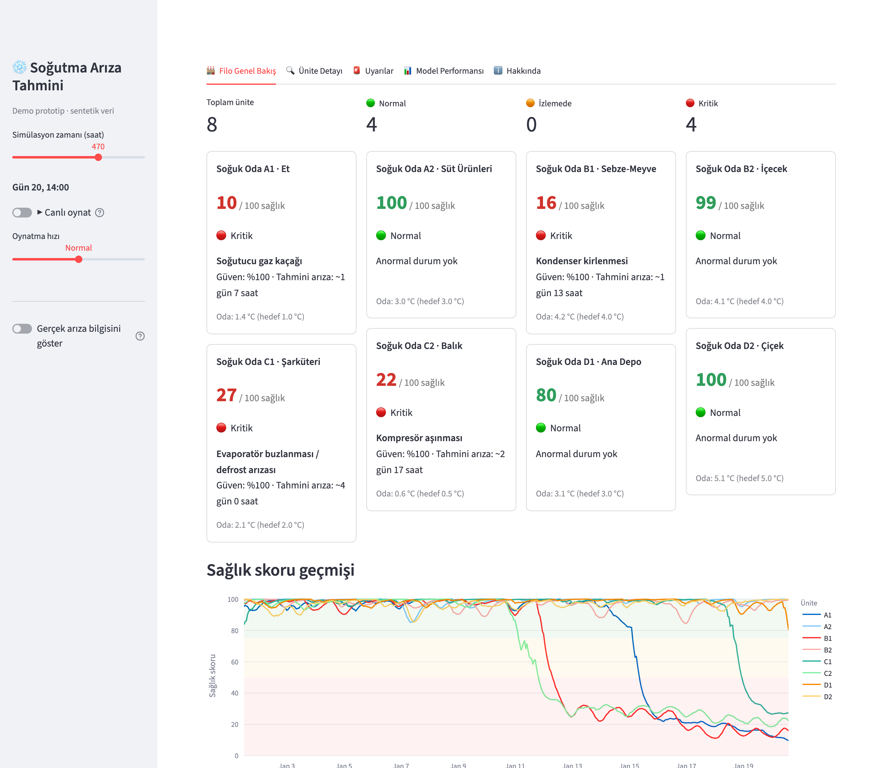
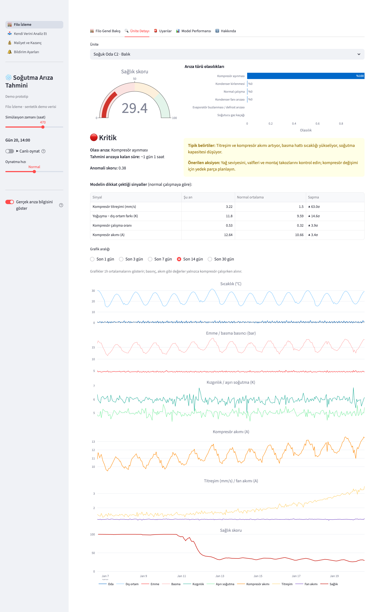
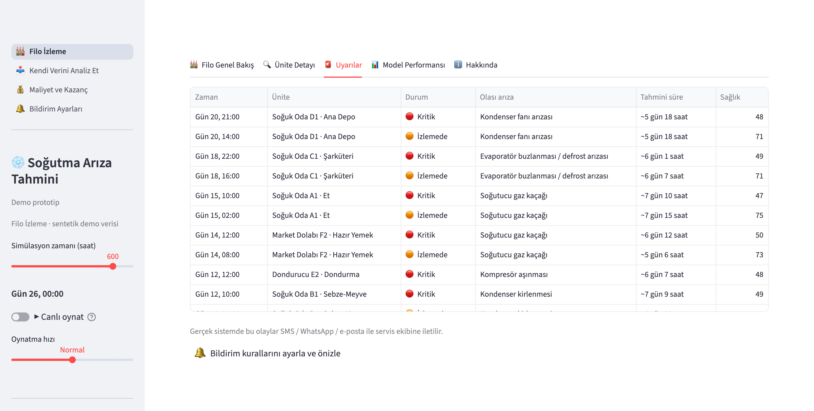
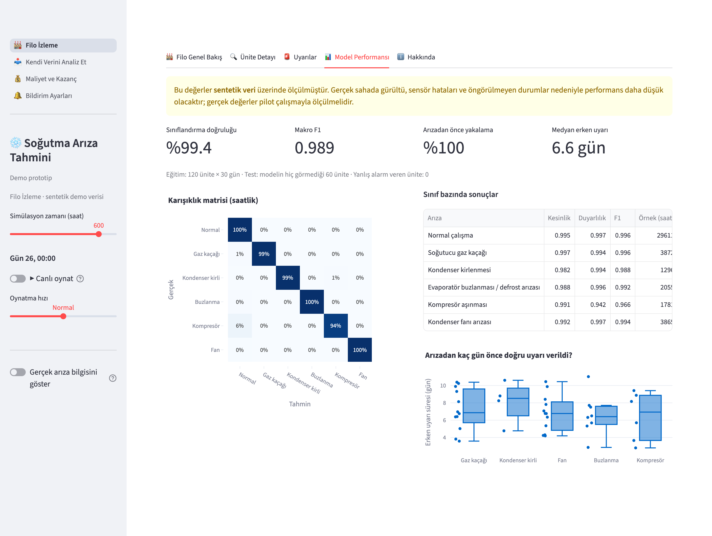
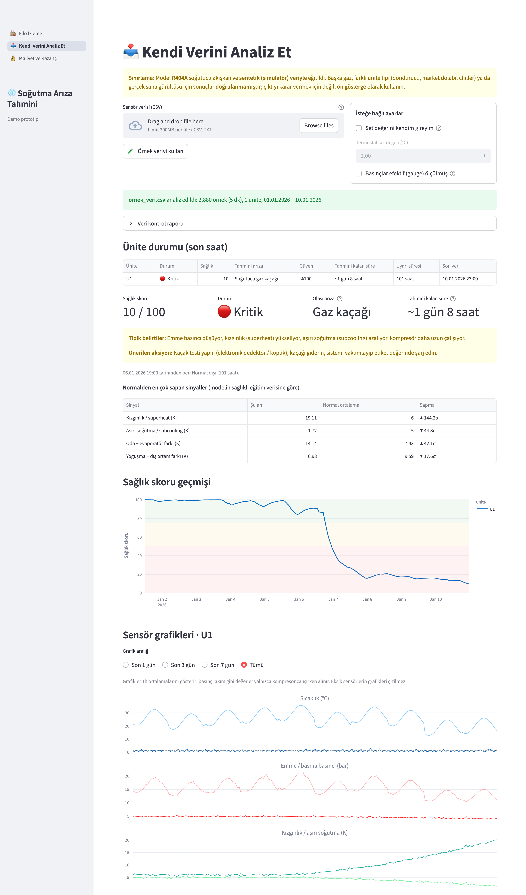
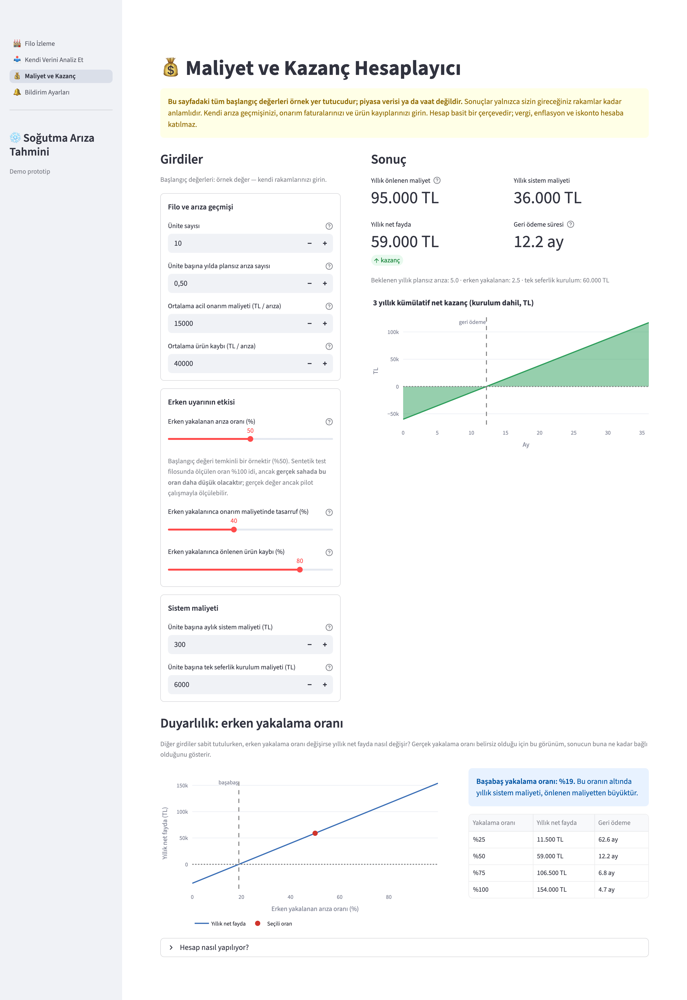
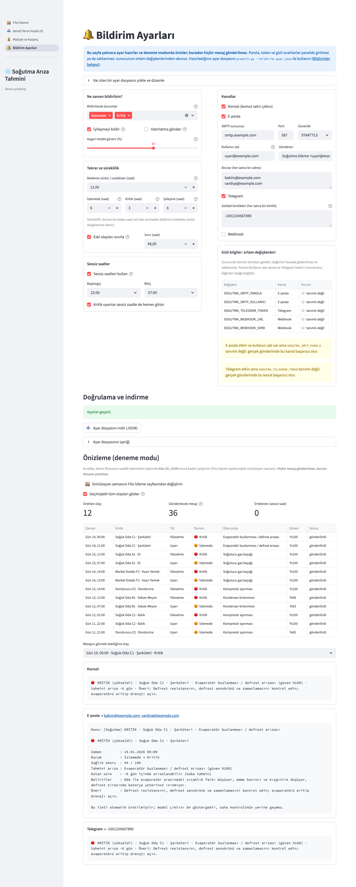
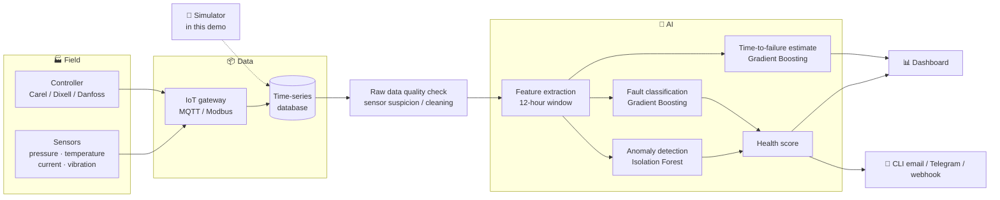

<div align="center">

# ❄️ AI-Powered Refrigeration Fault Prediction

**A predictive-maintenance prototype exploring early fault warnings for cold rooms, freezer rooms and supermarket display cabinets.**

[](https://github.com/mirzayildiran/sogutma-ariza-tahmini/actions/workflows/ci.yml)




</div>

---

## 🎯 Problem

When a cold room breaks down, the result is spoiled stock, an emergency service bill and lost customers.
Yet most faults **do not happen suddenly**: a refrigerant leak, a fouled condenser or a wearing compressor
leaves small traces in pressure, temperature, current and vibration data days in advance.
These traces are too small for the human eye to notice, but machine learning can pick them up.

**This project is a working demo prototype that aims to generate early warnings from refrigeration sensor data.**
It has not been validated on field data; model and sensor-quality results are limited to synthetic simulation.

> **Language note:** the documentation is in English. The dashboard, CLI messages, CSV report columns and source code
> identifiers are currently in Turkish (the project was built for the Turkish market). CLI flags such as `--tip` (equipment
> type) and `--gonder` (send) are explained where they appear.

## ✨ Features

- 🔍 **Distinguishes 5 fault types**: refrigerant leak, condenser fouling, evaporator icing, compressor wear, condenser fan failure
- 🧊 **3 equipment types**: cold room (≈0–5 °C), freezer room (≈−20 °C) and supermarket display cabinet; one model covers all of them
- ⏱️ **Estimates the time left until failure** (e.g. *"~6 days 9 hours"*)
- 💚 **0–100 health score**: 🟢 Normal · 🟠 Watch · 🔴 Critical
- 🧠 **Explainable predictions**: shows which signal the model focused on and how far it deviates from normal
- 🛠️ **Maintenance recommendations**: symptoms and recommended actions for each fault
- ▶️ **Live playback**: watch a 30-day scenario at accelerated speed
- 📥 **Analyze your own data**: upload a sensor CSV in the dashboard (or use the sample data) to see health, likely fault and time to failure per unit, and download an hourly report
- 💰 **Cost and benefit (ROI) calculator**: annual avoided cost, net benefit, payback period and sensitivity analysis with your own numbers
- 🔔 **Notification settings**: configure alert rules (persistence, cooldown, quiet hours) and channels (email, Telegram, webhook) in the dashboard, export them as JSON, and preview the messages for the demo fleet in **dry-run mode** (the dashboard never sends anything and never asks for passwords or tokens)
- 🧪 **Sensor-quality warnings**: flags stuck, disconnected, missing, noisy or physically inconsistent sensor readings separately from equipment-fault predictions, and neutralizes suspicious features in the model input. The thresholds are heuristic and have not been validated in the field.
- 🧪 **Physics-based simulator**: develop and test models without real data

The sensor-quality rules were developed for synthetic profiles and simplified physical relationships. False-alarm and miss rates
on real sensor data have not been measured; they must be calibrated on pilot data before being used as field thresholds. Details: [Data format](docs/data-format.md#51-sensor-health-data-quality-checks).

## 📸 Screenshots

<table>
<tr>
<td width="50%"><b>Unit detail</b>: with compressor wear, vibration and current rise slowly; the model warns 15 days ahead<br></td>
<td width="50%"><b>Alerts</b>: notifications for the service team<br><br><br><b>Model performance</b>: tested on virtual units the model has never seen (synthetic data)<br></td>
</tr>
<tr>
<td width="50%"><b>Analyze your own data</b>: upload a CSV and see the data-check report, unit status and sensor charts (shown with the sample CSV)<br></td>
<td width="50%"><b>Cost and benefit</b>: enter your own numbers; the starting values shown are placeholders only<br></td>
</tr>
<tr>
<td colspan="2"><b>Notification settings</b>: configure rules and channels (email / Telegram / webhook), export them as JSON, and preview which messages would be sent for the demo fleet in dry-run mode (nothing is sent)<br></td>
</tr>
</table>

## 🚀 Quick Start

```bash
git clone https://github.com/mirzayildiran/sogutma-ariza-tahmini.git
cd sogutma-ariza-tahmini
python3 -m venv .venv && source .venv/bin/activate
pip install -r requirements.txt
streamlit run app.py
```

On first launch, synthetic data is generated and the model is trained (about 30 seconds). The dashboard then opens at
`http://localhost:8501`. To retrain the model manually: `python train.py`

> 💡 Shareable link: `http://localhost:8501/?t=470` starts the dashboard at day 20.

## 📥 Predicting on Your Own Data

You can upload a CSV on the **📥 Analyze Your Own Data** page of the dashboard (or press *Use sample data*).
You can also analyze from the command line without the dashboard:

```bash
python predict.py examples/ornek_veri.csv -o report.csv
python predict.py freezer.csv --tip dondurucu   # equipment type: dondurucu (freezer) / market_dolabi (display cabinet); default soguk_oda (cold room)
```

Turkish Excel exports (`;` separator, decimal comma, Turkish column names) are supported; the program keeps running
when optional sensors are missing. For columns, units and limitations, see [Data format](docs/data-format.md).

Combined with an hourly cron job, it can also send **notifications** (email, Telegram, webhook).
Dry-run mode is the default; no message is sent unless `--gonder` (send) is given:

```bash
python predict.py data.csv --bildirim notification_settings.json           # dry run
python predict.py data.csv --bildirim notification_settings.json --gonder  # actually send
```

Details: [Notifications](docs/notifications.md).

## 🔌 API and Docker

The same analysis pipeline is also served as a **REST API** (FastAPI): an IoT gateway can send CSV or JSON measurements
and receive the health score, likely fault and time to failure for each unit.

```bash
pip install -r requirements-api.txt && python train.py
uvicorn api:app --port 8000                                  # docs: http://localhost:8000/docs
curl -F dosya=@examples/ornek_veri.csv http://localhost:8000/tahmin/csv

docker compose up --build        # dashboard: http://localhost:8501, API: http://localhost:8000
```

Endpoints, authentication (`SOGUTMA_API_ANAHTARI`), error codes and a gateway example: [REST API and Docker](docs/api.md).
The model is trained while the Docker image is built, so the image is self-contained.

## 🏗️ Architecture



> The field gateway/database is not implemented yet; in this demo the raw data comes from the physics-based **simulator**.
> The notification page only exports settings and shows previews; real channels are sent from the CLI and must be enabled explicitly.

## ⚙️ How It Works

### 1. Simulator
Each unit is simulated in 5-minute steps. The simulation accounts for a thermostat-controlled compressor,
periodic defrost, door/customer access, a daily outdoor temperature cycle and R404A saturation pressures.
There are three equipment types: **cold room** (20-minute defrost every 6 hours), **freezer room** (around −20 °C; evaporation
≈ −30 °C, i.e. ≈ 2 bar suction pressure, compression ratio ≈ 7, 30-minute electric defrost every 8 hours) and
**display cabinet** (high and variable load during store hours, low load at night with the night blind, narrow thermostat band).
Faults are added as a **severity** value (0 → 1) that progresses and accelerates over time. When severity reaches 1, the room
can no longer hold its temperature; this moment is the **failure time**.

### 2. Features
15 signals derived hourly from the raw data, plus 2 equipment-type flags:

| Signal | What it indicates |
|---|---|
| Superheat, subcooling | Refrigerant charge, expansion valve |
| Condensing − ambient difference | Condenser and fan efficiency |
| Room − evaporator difference | Evaporator icing, airflow |
| Compressor current, vibration, discharge line temperature | Mechanical condition of the compressor |
| Fan motor current | Bearing wear |
| Duty cycle, number of starts | Overall system load |
| Defrost peak temperature | Condition of the defrost heater |
| Equipment-type flags | Cold room / freezer / display cabinet |

### 3. Models

| Model | Task | Why? |
|---|---|---|
| **Isolation Forest** | Anomaly detection | Trained on healthy data only; needs no labels, so it works in the field from day one |
| **Gradient Boosting (classification)** | Fault type | Strong and fast on tabular data |
| **Gradient Boosting (regression)** | Time left until failure | For maintenance planning |

The health score is a weighted combination of the classifier's "normal" probability and the anomaly score.
To compare equipment types, the models see the **deviation from the healthy mean of the unit's own type** instead of raw values
(a freezer's normal suction pressure is ≈ 2 bar; a refrigerant leak means "lower-than-normal pressure, higher superheat" for every type).

## 📊 Results

The model was trained on 120 virtual units (60 cold rooms, 30 freezers, 30 display cabinets) and tested on **60 units it had never seen** (30 / 15 / 15):

| Metric | Value |
|---|---|
| Hourly classification accuracy | 99.4% |
| Macro F1 | 0.989 |
| Faults caught before they occurred | 100% (32 / 32) |
| Median early-warning lead time | **6.6 days** |
| Healthy units with a false alarm | 0 / 60 |
| Multiclass Brier / log-loss | 0.0100 / 0.0223 (unit-clustered bootstrap 95% CI: Brier 0.0065–0.0138; log-loss 0.0132–0.0332; no calibration applied) |
| Conditional ETA absolute error (MAE / p90) | 28.6 / 65.5 hours (MAE unit-clustered bootstrap 95% CI: 23.5–33.7 hours; 6,295 hours, 42 units) |
| ETA absolute error when the fault type is predicted correctly (MAE / p90) | 28.1 / 64.5 hours (6,216 hours, 42 units) |

The first ETA metric does not require the alarm to identify the correct fault type; the second one requires a correct type match. Both
metrics cover only test hours with a positive true time to failure.
A 10-bin one-vs-rest reliability summary of the raw class probabilities gave a macro ECE of 0.0013; because of class imbalance and sparse
high-probability bins, this number is not evidence of calibration. Confidence intervals are computed over unit clusters;
hours are not treated as independent samples. There is no calibrator and no prediction interval for a single ETA estimate.
All numbers come from a synthetic test fleet generated from the same distribution; they must not be read as field performance.

Constant ambient-shift stress test (same test fleet, synthetic): at −8 °C, accuracy 99.32% and 1/60 false alarms;
at +8 °C, accuracy 99.35% and 3/60 false alarms. This constant-offset experiment is not evidence of real seasonal robustness.

By equipment type (indicative only, since the test fleet has 15–30 units per type):

| Type | Units | Hourly accuracy | Caught | Median early warning | False alarms |
|---|---|---|---|---|---|
| Cold room | 30 | 99.6% | 16 / 16 | 5.2 days | 0 |
| Freezer room | 15 | 99.3% | 8 / 8 | 7.3 days | 0 |
| Display cabinet | 15 | 99.1% | 8 / 8 | 7.7 days | 0 |

**Demo scenarios** (12 units; "Day N" is the dashboard's numbering):

| Unit | Fault | First warning | Failure | Early warning |
|---|---|---|---|---|
| A1 · Meat | Refrigerant leak | Day 15 | Day 22 | ~7 days |
| B1 · Fruit & Veg | Condenser fouling | Day 12 | Day 23 | ~11 days |
| C1 · Deli | Evaporator icing | Day 18 | Day 24 | ~5 days |
| C2 · Fish | Compressor wear | Day 11 | Day 26 | ~14 days |
| D1 · Main Store | Condenser fan | Day 20 | Day 25 | ~4 days |
| E2 · Freezer (Ice Cream) | Compressor wear | Day 11 | Day 24 | ~13 days |
| F2 · Display Cabinet (Ready Meals) | Refrigerant leak | Day 14 | Day 22 | ~8 days |
| A2, B2, D2, E1, F1 | Healthy | — | — | no false alarms ✅ |

> [!IMPORTANT]
> These values were measured on **synthetic data**. In the field, performance will be lower because of sensor noise, faulty sensors,
> multiple simultaneous faults and situations the simulator does not model. Real values can only be measured in a pilot.

## 📚 Documentation

| Document | Contents |
|---|---|
| [Model card](docs/model-card.md) | The model's purpose, data, metrics, limitations and what must be validated in a pilot |
| [Project proposal draft](docs/project-proposal.md) | Draft for an R&D funding application: objectives, work packages, risks, commercialization |
| [Data format](docs/data-format.md) | Preparing your own CSV: columns, units, missing sensors |
| [Notifications](docs/notifications.md) | Alert rules, channels (email / Telegram / webhook), environment variables |
| [Field architecture](docs/field-architecture.md) | Moving to a real site: sensors, IoT gateway, MQTT, database, security |

## 🧪 Tests

```bash
pip install -r requirements-dev.txt
pytest          # simulator, feature, model and dashboard tests (~10 s, trains on a small fleet)
ruff check .    # lint
```

## 📁 Project Structure

```
├── app.py                  # Streamlit dashboard (entry point, page navigation)
├── sayfalar/               # Dashboard pages
│   ├── filo.py             # Fleet Monitoring (demo fleet)
│   ├── analiz.py           # Analyze Your Own Data (CSV upload)
│   ├── maliyet.py          # Cost and Benefit (ROI) calculator
│   └── bildirim.py         # Notification Settings (rules, channels, dry-run preview)
├── train.py                # Data generation, training, evaluation
├── predict.py              # Batch prediction on your own CSV
├── api.py                  # REST API entry point (uvicorn api:app); code: sogutma/api.py
├── Dockerfile              # Single image: API + dashboard
├── docker-compose.yml      # api (8000) and dashboard (8501) services
├── sogutma/
│   ├── simulator.py        # Physics-based simulator: cold room, freezer, display cabinet
│   ├── features.py         # Feature extraction
│   ├── model.py            # Anomaly + classification + time to failure
│   ├── ingest.py           # CSV reading, validation, 5-minute alignment
│   ├── bildirim.py         # Alert rules and notification channels
│   ├── analiz.py           # CSV/JSON → prediction pipeline (shared by predict.py, the dashboard and the API)
│   ├── veri_kalitesi.py    # Sensor-quality detection, reporting and neutralizing suspicious features
│   ├── api.py              # FastAPI application (prediction service)
│   ├── roi.py              # Cost / benefit calculation (pure functions)
│   ├── ui.py               # Shared dashboard helpers (loading, formatting, charts)
│   └── faults.py           # Fault types, symptoms, maintenance recommendations
├── examples/               # Sample CSV and generator script
├── tests/                  # pytest tests
└── docs/                   # Documentation and screenshots
```

## 🗺️ Roadmap

- [x] Physics-based simulator and 5 fault scenarios
- [x] Anomaly detection, fault classification, time-to-failure estimation
- [x] Monitoring dashboard, alerts, explainable predictions
- [x] Dashboard: page for uploading a CSV and analyzing your own data
- [x] Dashboard: cost and benefit (ROI) calculator
- [x] Freezer (−18 °C) and display cabinet types
- [x] Sensor-fault simulation and heuristic data-quality warnings (synthetic test; not a field threshold)
- [x] Local prototype deployment with a REST API and Docker Compose
- [x] CLI email / Telegram / webhook notifications; settings export and dry-run preview in the dashboard
- [ ] Chiller type
- [x] MQTT v1 telemetry message validation / canonical-field normalizer prototype (no broker connection)
- [x] Local SQLite telemetry staging store; idempotent replay and site/unit scoping (not a production DB)
- [ ] Live data ingestion over MQTT; reconnection/buffering and a pilot sensor / IoT gateway (MQTT, Modbus)
- [ ] Fine-tuning the model with real data and service records
- [x] Synthetic validation: conditional ETA error, reliability bins and unit-bootstrap intervals, uncalibrated Brier/log-loss, ±8 °C constant ambient shift
- [ ] Probability calibration and ETA prediction intervals with separate calibration units; simultaneous equipment faults and real seasonal profiles
- [ ] Cloud deployment and multi-tenant support

Detailed roadmap: [ROADMAP.md](ROADMAP.md).

## 📄 License

[MIT](LICENSE) © 2026 Ahmet Mirza Yıldıran
