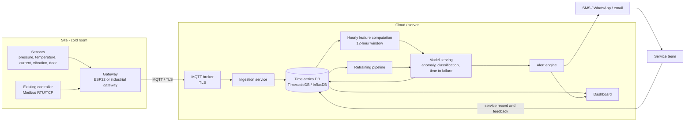
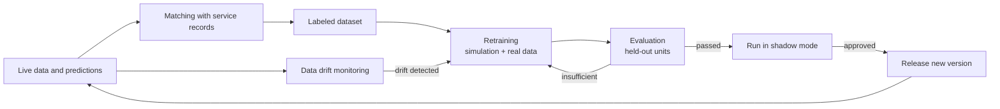
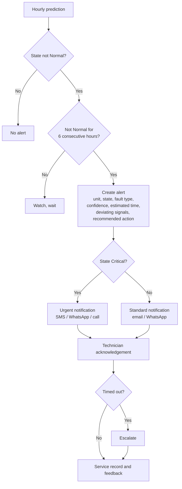

# Field Architecture — From Demo Prototype to a Real Site

This document describes the **proposed** field and data architecture for turning the demo prototype (synthetic data)
into a system that runs on real cold rooms. It is a design proposal; no component has been tried in the field yet.
Sensor models, ranges and sampling rates are **starting suggestions** and must be validated against equipment
manufacturer documentation and site conditions before a pilot. Hardware costs are deliberately left out; they should be
determined by requesting quotes.

Related documents: [Model Card](model-card.md) · [Project Proposal](project-proposal.md) ·
Real data format: [Data format](data-format.md) ·
Repository: <https://github.com/mirzayildiran/sogutma-ariza-tahmini>

## Contents

1. [Design principles](#1-design-principles)
2. [Architecture overview](#2-architecture-overview)
3. [Quantities to measure and sensors](#3-quantities-to-measure-and-sensors)
4. [Sampling rates](#4-sampling-rates)
5. [Gateway options](#5-gateway-options)
6. [MQTT topic structure and data format](#6-mqtt-topic-structure-and-data-format)
7. [Storage](#7-storage)
8. [Model serving and the retraining loop](#8-model-serving-and-the-retraining-loop)
9. [Alert flow](#9-alert-flow)
10. [Security](#10-security)
11. [Phased rollout](#11-phased-rollout)

---

## 1. Design principles

- **Monitoring only:** the system never writes commands to the refrigeration controller; it uses sensors and read-only
  Modbus access. This way, existing protection and control logic is unaffected if something fails.
- **Not protective equipment:** the system does not replace a pressure switch, thermal relay, alarm device or an official
  temperature record (e.g. HACCP).
- **Offline resilience:** when the internet connection drops, the gateway buffers data locally and sends it when the
  connection returns.
- **Outbound connections:** only outbound connections from the site to the cloud; no inbound port is opened on site.
- **Training–serving consistency:** features must be computed with the same code as in training (`sogutma/features.py`).
- **Data quality first:** the current analysis pipeline heuristically flags stuck, out-of-range or disconnected sensors
  before the model; the classifier has no sensor-fault label, and the quality thresholds need field validation (see the
  [Model Card](model-card.md#8-limitations-and-risks)).

## 2. Architecture overview



In the current demo, the simulator takes the place of the site layer; the feature, model and dashboard layers are the
code in this repository. On the MQTT side, there is a pure Python adapter (`sogutma/mqtt_contract.py`) that validates a
single v1 telemetry message and maps it to the REST API's canonical measurement fields, and a local SQLite staging store
(`sogutma/mqtt_store.py`). There is no broker connection/consumer, gateway spool or production time-series database.
Persistent ingestion, the alert engine and the retraining pipeline on the cloud/server side are what this document
proposes and are **not implemented yet**.

## 3. Quantities to measure and sensors

The demo model's 15 features (see the [Model Card](model-card.md#4-features)) are derived from the measurements below.
The sensor types in the table are examples; the choice depends on the equipment's capacity, refrigerant and ambient
conditions.

| Quantity | Where it is installed | Sensor type (suggestion) | Output | Model input |
|---|---|---|---|---|
| Suction pressure | Compressor suction line service port (Schrader/tee) | Pressure transducer; e.g. 0–10 / 0–16 bar range [range to be chosen] | 4–20 mA or 0.5–4.5 V ratiometric | `p_suc`; required for `evap_delta`, `sh` |
| Discharge (condensing) pressure | Compressor discharge line / condenser inlet | Pressure transducer; e.g. 0–30 bar, 4–20 mA | 4–20 mA | `p_dis`; required for `cond_approach`, `sc` |
| Suction line temperature | Evaporator outlet / compressor inlet, clamped and insulated on the pipe | PT1000 or NTC (pipe clamp) | Resistance / ADC | `sh` (superheat) = suction line temperature − saturation temperature(`p_suc`) |
| Liquid line temperature | Condenser outlet / liquid line before the expansion valve | PT1000 or NTC | Resistance / ADC | `sc` (subcooling) = saturation temperature(`p_dis`) − liquid line temperature |
| Discharge line temperature | Discharge line close to the compressor outlet | PT1000 (high temperature range) | Resistance / ADC | `t_dis` |
| Room temperature | Inside the room, away from the airflow and the door, at product height | PT1000 / NTC (or the controller's probe) | Resistance / Modbus | `t_room_dev` (the target temperature is also recorded), `evap_delta` |
| Evaporator coil / defrost temperature | Evaporator coil, next to the defrost termination sensor | PT1000 / NTC (or the controller's defrost probe) | Resistance / Modbus | `coil_defrost_peak` |
| Ambient temperature | At the condenser air inlet, shielded from direct sunlight | PT1000 / NTC (with a radiation shield) | Resistance / ADC | `t_amb`, `cond_approach` |
| Compressor current | Compressor supply phase (on 3-phase, preferably each phase) | Split-core current transformer / current sensor, range suited to the unit's current | 4–20 mA, 0–10 V or Modbus | `i_comp`; also the running state |
| Condenser fan current | Condenser fan motor supply | Split-core current sensor (small current range) | 4–20 mA / 0–10 V | `i_fan` |
| Vibration | Compressor body (solid metal surface, magnetic or screw mount) | MEMS accelerometer (preferably 3-axis, industrial housing) | I²C/SPI or a module with digital output | `vib` — computed at the edge as RMS velocity in mm/s |
| Door state | Room door | Magnetic (reed) contact | Digital input | Not used by the current model; recorded for context and future features |
| Compressor / defrost state | Contactor auxiliary contact or controller output | Dry contact / digital input or Modbus | Digital | `duty`, `starts`; separating defrost periods |
| Target temperature (setpoint) | From the controller | Modbus read or manually entered metadata | — | `t_room_dev` |

Points to watch:

- **Absolute/gauge pressure:** the simulator produces pressure as **absolute (bar)**, and the saturation curve uses
  absolute pressure. Field transducers usually report **gauge** pressure; it must be converted to absolute
  (≈ +1.013 bar), or the model must be retrained accordingly.
- **Saturation temperature:** the demo code uses an approximate Antoine-type curve for R404A (`ln P = A − B/(T + C)`)
  (`sogutma/simulator.py`). In the field, an accurate saturation table/library for the refrigerant in use (e.g. CoolProp)
  must be used; when the refrigerant changes, the features and the model must be re-evaluated.
- **Superheat / subcooling:** produced directly in the demo data; in the field they are computed from measured
  temperature and pressure, so the quality of the temperature sensor's pipe contact and insulation determines accuracy.
- **Vibration:** in mm/s in the simulator. Band-limited RMS velocity is computed from raw acceleration data; because
  absolute values on their own are site-specific, per-unit calibration is required.
- **Compressor running state:** can be derived from a current threshold or a contactor contact; for defrost information,
  the controller output or the coil's temperature profile can be used.
- **Installation safety:** connections to the pressure line and work in the electrical panel must be done by a qualified
  refrigeration/electrical technician. **External (clamp-on) and insulated** measurement is preferred wherever possible.
- **Existing controller:** many controllers expose room, defrost and sometimes pressure/current data over Modbus; which
  data can be read depends on the device model and must be verified against its register map. In that case, fewer
  additional sensors are needed.

## 4. Sampling rates

The values below are starting suggestions. The demo model works with **5-minute** data; fast sampling is summarized at
the edge and reduced to 5-minute records.

| Signal group | Sampling on the edge device | Sent to the cloud |
|---|---|---|
| Temperatures (room, evaporator, pipes, ambient) | 10–30 s | 5-minute mean (optional min/max) |
| Pressures | 1–5 s | 5-minute mean, min, max |
| Currents (compressor, fan) | 1 s or faster (to see the inrush current) | 5-minute mean, max |
| Vibration | A short high-rate capture (e.g. a few seconds, in the kHz range) every 5 minutes | RMS velocity, peak value and optional band energies; raw waveform only for diagnosis/development, rarely |
| Compressor / defrost / door state | Event-based (on change) and 1 s polling | Event records + run time / number of starts within the 5 minutes |

Rationale: the model uses the hourly mean of values taken while the compressor is running (outside defrost). For this
reason, each 5-minute record should also mark a summary of the samples taken while the compressor was running. Whether
the frequency and resolution of real field data suit the model must be validated in the pilot.

## 5. Gateway options

| Option | When it fits | Pros | Cons / caveats |
|---|---|---|---|
| **Custom ESP32-based board** | Pilot, low-cost repeatable installation; analog and digital inputs directly | Low power and cost; Wi-Fi/Ethernet; MQTT/TLS libraries available | Limited built-in ADC accuracy: an external ADC (e.g. 16-bit) and a shunt/protection circuit for 4–20 mA are recommended; industrial EMC and enclosure design is needed; limited memory for local buffering |
| **Raspberry Pi-class board / industrial IoT gateway** | Multiple units, local data buffering, feature computation at the edge | Linux environment; Modbus, MQTT, local database and remote-update tools; industrial versions are DIN-rail mountable | SD card endurance and temperature range can be a problem on consumer boards; industrial versions are expensive |
| **Reading from the existing controller over Modbus** | When the device supports Modbus RTU (RS-485) / TCP and its data is sufficient | Fewer extra sensors and less wiring; quick installation | Which variables are exposed depends on the model (pressure, current and vibration are usually missing); must be used read-only; the manufacturer's register map and authorization terms must be verified |
| **Hybrid** | The most likely option in practice | Room/defrost/outputs from the controller; pressure, current and vibration from extra sensors | Time synchronization and data matching between the two sources are required |

Gateway tasks: reading and scaling sensors; converting 4–20 mA and ADC values to engineering units; 5-minute
summarizing; data-quality flags; local buffering; sending over MQTT/TLS; clock synchronization (NTP); remote
configuration and signed software updates.

Connectivity: Ethernet (preferred) or Wi-Fi; a cellular modem as backup. The connection type is chosen according to the
business's network policy.

## 6. MQTT topic structure and data format

This section is the **v1 contract** for the target architecture. `sogutma/mqtt_contract.py` validates a message and
converts it into a REST measurement row; `sogutma/mqtt_store.py` stores the fully validated message in a local SQLite file
under a site/unit/time key and reads window rows that can be passed to the REST API. This is a single-process local
staging prototype; there is no broker consumer, reconnection, gateway spool or production telemetry store. The current
demo API is stateless and requires a window of at least 24 hours per unit on every request; the single-message adapter
does not create a prediction request on its own.

### Topic structure (proposal)

```
sogutma/v1/{site_id}/{unit_id}/telemetry     # 5-minute summary measurements (QoS 1)
sogutma/v1/{site_id}/{unit_id}/events        # events: door, defrost, compressor start/stop (QoS 1)
sogutma/v1/{site_id}/{gateway_id}/status     # device status, last seen (retained, with LWT)
sogutma/v1/{site_id}/{gateway_id}/config     # remote configuration (server → device)
```

- `site_id`: business/location, `unit_id`: refrigeration unit, `gateway_id`: gateway.
- Each device must only be able to publish to **its own subtopics** (with broker access control lists; see
  [Security](#10-security)).
- When a device disconnects, `offline` is written to the `status` topic through a Last Will message.
- Telemetry publications must use QoS 1 with **retain off**; old retained samples must not be taken as current data after
  a reconnection.
- The schema version is carried in the topic path (`v1`) and in the message (`schema`).

### Sample `telemetry` message

Field names are consistent with the simulator's column names. Derived values (`sh`, `sc`) can be computed together with
the raw sensor values either on the gateway or on the server; computing them on the server makes it easier to update the
refrigerant table centrally.

```json
{
  "schema": 1,
  "ts": "2027-03-14T09:05:00Z",
  "site_id": "S001",
  "unit_id": "A1",
  "gateway_id": "GW-0001",
  "interval_s": 300,
  "setpoint_c": 2.0,
  "t_amb": 22.4,
  "t_room": 2.6,
  "t_coil": -4.1,
  "p_suc_bar": {"mean": 3.9, "min": 3.6, "max": 4.2},
  "p_dis_bar": {"mean": 13.8, "min": 13.1, "max": 14.4},
  "t_suction_line": 6.5,
  "t_liquid_line": 29.8,
  "t_dis": 71.2,
  "i_comp_a": {"mean": 8.9, "max": 22.5},
  "i_fan_a": 1.2,
  "vib_rms_mms": 1.6,
  "comp_run_s": 210,
  "comp_starts": 1,
  "defrost_s": 0,
  "door_open_s": 14,
  "pressure_ref": "absolute",
  "refrigerant": "R404A",
  "quality": {"p_suc": "ok", "p_dis": "ok", "t_liquid_line": "ok", "vib": "ok"},
  "fw": "0.1.0"
}
```

Note: the values in the message are made up only to illustrate the format; they do not represent a real measurement.

Rules validated by the v1 adapter: the topic can only be `sogutma/v1/{site_id}/{unit_id}/telemetry`, and the payload's
`site_id`/`unit_id` must match the topic; `schema` must be exactly `1`, `interval_s` exactly 300 seconds, the payload at
most 64 KiB, and `ts` an RFC 3339 time with a UTC `Z` or an explicit offset that, once normalized, is aligned to a UTC
5-minute boundary. The fields `t_amb`, `t_room`, `p_suc_bar`, `p_dis_bar` and `i_comp_a` must be present; if a sensor
could not be read, the corresponding scalar/mean may be `null`. `ts` is the **end** of the 5-minute window; the
measurement summary covers the interval `(ts - 300 seconds, ts]`. The adapter converts the offset to UTC. Pressure means
are converted to bar(a) according to `pressure_ref` (+1.013 bar if `gauge`); for the fan/compressor and
temperature/pressure summaries, only the mean is passed to the model input. Durations (`comp_run_s`, `defrost_s`,
`door_open_s`) are seconds within the same 300-second window, and the API flag becomes `true` if they are positive.
`site_id`, `gateway_id`, `quality`, `refrigerant`, `fw` and `comp_starts`, which the API does not represent, are kept as
provenance in the normalized output; quality codes do not change the model decision yet. Missing sensor means stay
`null`; they are not converted to zero. Because the unit type is not part of the v1 payload, the current REST default
`soguk_oda` (cold room) is used. Incompatible payloads or payloads with extra fields are rejected. These mappings have
not been validated on hardware or against a broker.

Time/site rules a future broker consumer will use: `ts` must be UTC RFC 3339 (`Z` or an explicit offset); time is
normalized to UTC, and the site time zone is only for display/reporting. `site_id` must be kept in the MQTT topic and the
persistent store; `unit_id` in the current REST/CSV prediction schema is not a tenant identifier on its own.
`p_suc_bar.mean` / `p_dis_bar.mean` are converted by the adapter into the canonical absolute pressures `p_suc` / `p_dis`;
`pressure_ref` is required. A missing measurement is carried as `null` with a quality code; it is not converted to zero.

QoS 1 may redeliver. The SQLite prototype accepts the same normalized v1 payload under the key
`(site_id, unit_id, ts_utc)` idempotently; it rejects different contract content under the same key and does not
overwrite the old record. JSON field order/whitespace and equivalent UTC offset notations are not counted as repeats.
Late records are ordered by timestamp. The query window has the form `(start, end]`; no synthetic rows are added for
missing times. Before calling the REST API, always query a single site and a single unit; the API schema has no
`site_id`. For long outages, a persistent spool and exponential backoff on the gateway side are still design/implementation
work; there is no claim of an MQTT delivery guarantee or production-tested behavior.

### Sample `events` message

```json
{"schema": 1, "ts": "2027-03-14T09:12:41Z", "unit_id": "A1", "type": "door_open", "duration_s": 38}
```

## 7. Storage

**Implemented local prototype:** `SQLiteTelemetryStore` stores the validated full MQTT envelope in a local SQLite file;
the schema is marked with `PRAGMA user_version=1`, it locks within a single process, and in file mode it uses WAL and a
busy timeout. Adding a message requires the output of `normalize_telemetry`. `query_window(site_id, unit_id, start, end)`
returns only the requested site/unit and real measurement rows in the window `(start, end]` (at most 366 days); it does
not fill gaps. `api_rows` likewise returns rows for a single site/unit; missing samples, the 24-hour requirement,
freshness and measurement quality are evaluated by the existing ingest/API.
This store is for a low-volume local prototype: retention/cleanup, backup, full-disk handling, encryption, high
availability and a multi-process write policy are not implemented. It must not be used on a network file system or as a
production database.

For time-series data, **TimescaleDB** (a PostgreSQL extension; SQL, easy joins with relational metadata) or
**InfluxDB** can be used. With TimescaleDB, service records, unit metadata and model outputs can be kept in the same
database. The choice should be based on the team's experience and the operating cost.

### Sample table schema (TimescaleDB)

```sql
CREATE EXTENSION IF NOT EXISTS timescaledb;

-- Unit metadata
CREATE TABLE units (
    unit_id      TEXT NOT NULL,
    site_id      TEXT NOT NULL,
    name         TEXT,
    refrigerant  TEXT NOT NULL,          -- e.g. R404A
    setpoint_c   REAL,
    installed_at TIMESTAMPTZ,
    PRIMARY KEY (site_id, unit_id)
);

-- 5-minute raw/summary measurements
CREATE TABLE telemetry (
    ts         TIMESTAMPTZ NOT NULL,
    site_id    TEXT NOT NULL,
    unit_id    TEXT NOT NULL,
    t_amb      REAL,
    t_room     REAL,
    t_coil     REAL,
    p_suc      REAL,        -- bar (absolute)
    p_dis      REAL,        -- bar (absolute)
    sh         REAL,        -- superheat, K (derived)
    sc         REAL,        -- subcooling, K (derived)
    i_comp     REAL,        -- A
    i_fan      REAL,        -- A
    vib        REAL,        -- mm/s RMS
    t_dis      REAL,
    comp_on    BOOLEAN,
    defrost    BOOLEAN,
    door_open  BOOLEAN,
    quality    JSONB,
    PRIMARY KEY (site_id, unit_id, ts),
    FOREIGN KEY (site_id, unit_id) REFERENCES units(site_id, unit_id)
);
SELECT create_hypertable('telemetry', 'ts');

-- Model outputs (hourly)
CREATE TABLE predictions (
    ts          TIMESTAMPTZ NOT NULL,
    site_id     TEXT NOT NULL,
    unit_id     TEXT NOT NULL,
    model_ver   TEXT NOT NULL,
    health      REAL,
    status      TEXT,                  -- Normal / İzlemede (Watch) / Kritik (Critical)
    pred_fault  TEXT,
    confidence  REAL,
    anomaly     REAL,
    eta_h       REAL,
    PRIMARY KEY (site_id, unit_id, ts, model_ver),
    FOREIGN KEY (site_id, unit_id) REFERENCES units(site_id, unit_id)
);

-- Alerts
CREATE TABLE alerts (
    alert_id    BIGSERIAL PRIMARY KEY,
    opened_at   TIMESTAMPTZ NOT NULL,
    closed_at   TIMESTAMPTZ,
    site_id     TEXT NOT NULL,
    unit_id     TEXT NOT NULL,
    severity    TEXT NOT NULL,
    pred_fault  TEXT,
    message     TEXT,
    ack_by      TEXT,
    ack_at      TIMESTAMPTZ,
    FOREIGN KEY (site_id, unit_id) REFERENCES units(site_id, unit_id)
);

-- Service records: for labeling and retraining
CREATE TABLE service_events (
    event_id     BIGSERIAL PRIMARY KEY,
    site_id      TEXT NOT NULL,
    unit_id      TEXT NOT NULL,
    visited_at   TIMESTAMPTZ NOT NULL,
    fault_type   TEXT,             -- confirmed fault (e.g. gaz_kacagi = refrigerant leak)
    onset_est_at TIMESTAMPTZ,      -- estimated onset
    failure_at   TIMESTAMPTZ,      -- failure time (if any)
    action       TEXT,
    notes        TEXT,
    FOREIGN KEY (site_id, unit_id) REFERENCES units(site_id, unit_id)
);
```

Notes:

- **Retention:** a retention period for raw 5-minute data and hourly summaries (continuous aggregates) for older data are
  recommended: [retention periods to be decided].
- The cloud provider or server should be chosen according to data residency and KVKK (Turkish personal data protection
  law) requirements.
- Service records are the source of **label quality**; keeping disciplined records of fault type and failure time is
  critical for the model to improve on real data.

## 8. Model serving and the retraining loop

### Serving

The current model works with **hourly** features and uses a 12-hour window; real-time stream processing is therefore not
needed, and an **hourly batch job** is enough:

1. At the top of every hour, fetch the latest data for each unit (at least 12 hours to warm up the window).
2. Compute hourly features with `sogutma/features.py` (mean of samples taken while the compressor is running, 12-hour
   rolling window).
3. Use `FaultPredictor.predict` to produce the anomaly score, fault probabilities, health score, state, likely fault and
   estimated time.
4. Write the results to the `predictions` table; run the alert rules.

Implementation notes:

- The exponential smoothing in the health score (EWM, span = 12 hours) needs history; it must be computed with a
  continuously running state or with a sufficient history window.
- A small service (e.g. REST) or a scheduled job is enough to serve the model; the model file is stored with a version
  number, and `model_ver` is recorded with every prediction.
- Because the model is stored with `joblib`, only files produced from a trusted source should be loaded.

### Retraining loop



- **Labeling:** fault type, estimated onset and failure time are extracted from service records; long periods without
  records are separately verified under a "healthy" assumption.
- **Shadow mode:** the new version runs in parallel with the live version for a while without sending alerts; the outputs
  are compared.
- **Data drift monitoring:** feature distributions and the anomaly score distribution are monitored (seasonality, changes
  after maintenance).
- **Evaluation:** on units/businesses not used in training; catch rate, early-warning lead time, false alarms and
  time-to-failure error are measured. The results are recorded in the Model Card.
- **Versioning and rollback:** every version is recorded; if there is a problem, it is possible to roll back to the
  previous version.

## 9. Alert flow



- **Persistent alert rule:** in evaluation (`train.py`), an alarm means the state stays outside Normal for **6 consecutive
  hours**; it is recommended to start with this rule for live alerts too and to calibrate the threshold in the pilot.
- **Alert content:** the typical symptoms and recommended action from `faults.py`, the signals the model drew attention to
  (`explain`), confidence and estimated time. The time is an approximate urgency, not an exact date (see the Model Card).
- **Channels:** SMS, WhatsApp, email and dashboard notifications. WhatsApp requires a business account and approved message
  templates; SMS and WhatsApp provider terms must be verified separately.
- **Noise management:** merging repeated alerts for the same unit, muting and closing rules; alert acknowledgement and
  resolution records (the `alerts` table).
- **Device alerts:** no incoming data, out-of-range/stuck sensor values and an offline gateway are alerts **separate** from
  equipment faults.

## 10. Security

| Area | Recommendation |
|---|---|
| **Transport encryption** | TLS (current version) between device–broker and cloud services; certificate verification |
| **Device authentication** | A unique identity per device: preferably a client certificate (mTLS), alternatively a device-specific user/password or token. No shared common password |
| **Authorization** | Broker ACL: a device may only publish to its own `site/unit` topics and subscribe to its own `config` topic |
| **Network separation** | Separate the refrigeration/control network from the IT network (VLAN or a separate line); the gateway only makes outbound connections; no inbound port is opened |
| **Read-only access** | Only read operations on controllers over Modbus; write functions are not used |
| **Secrets** | Keys and passwords in a secure store, not in the code; secure storage on the device where possible |
| **Software updates** | Signed and verified remote updates; a rollback mechanism |
| **Physical security** | Enclosure and lock; unused ports disabled; default passwords changed |
| **Dashboard access** | User authentication, role-based permissions, per-customer data separation; audit logs |
| **Time synchronization** | NTP; consistent timestamps on the device and the server |
| **Backup and monitoring** | Database backups; service and device health monitoring |
| **Data privacy** | Business data is separated per customer; if it contains personal data, it is assessed under KVKK and data minimization is applied |
| **Model files** | `joblib`/pickle files are loaded only from trusted and signed sources |

## 11. Phased rollout

| Phase | Contents | Exit criterion |
|---|---|---|
| 0. Preparation | Pilot site selection, equipment/refrigerant inventory, extracting controller Modbus maps | Inventory and site agreement |
| 1. Data collection | Installing sensors and the gateway; data collection and data-quality monitoring only | Data-quality target [to be decided] met |
| 2. Shadow mode | The model runs and outputs are recorded, no alerts are sent; service records are matched | False-alarm and catch-rate evaluation |
| 3. Calibration | Fine-tuning thresholds, anomaly and health-score weights and, if needed, the model with real data | Acceptance criteria [to be decided] |
| 4. Live alerts | Sending alerts to the service team for selected units | User feedback, alert-to-action time |
| 5. Scale-out | More units and businesses; multi-customer operation | Operations and support processes |

At every phase, results measured on real data must be recorded in the
[Model Card](model-card.md#9-what-must-be-validated-in-a-pilot) table.
