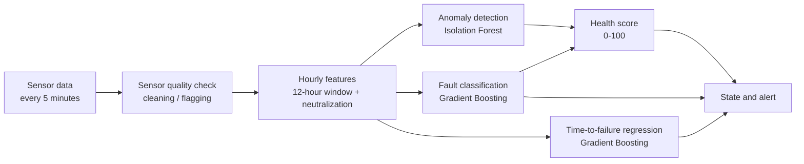

# Model Card — Refrigeration Fault Prediction (Demo Prototype)

> **Status:** demo prototype. The model was trained and evaluated on **synthetic (simulator) data** only.
> The performance numbers in this document do **not** represent real field performance; they only show that the method
> works in the simulator environment. Real performance must be measured in a pilot (see
> [What must be validated in a pilot](#9-what-must-be-validated-in-a-pilot)).

The numerical results are taken from the `models/metrics.json` file produced by running `python train.py`
(the results are reproducible because the training and test data are generated with fixed random seeds).
The code details in this document are based on the source code in `train.py` and the `sogutma/` package.

## Contents

1. [General information](#1-general-information)
2. [Purpose and intended use](#2-purpose-and-intended-use)
3. [Data: physics-based simulator](#3-data-physics-based-simulator)
4. [Features](#4-features)
5. [Models and rationale](#5-models-and-rationale)
6. [Health score](#6-health-score)
7. [Evaluation results](#7-evaluation-results)
8. [Limitations and risks](#8-limitations-and-risks)
9. [What must be validated in a pilot](#9-what-must-be-validated-in-a-pilot)

---

## 1. General information

| Field | Value |
|---|---|
| Name | Refrigeration Fault Prediction — predictive maintenance model |
| Version | Demo prototype |
| Task | Fault type detection, time-to-failure estimation and a 0–100 health score for cold room, freezer room and display cabinet refrigeration units |
| Input | Hourly features (from 5-minute sensor data, with a 12-hour rolling window) and the unit's equipment type |
| Output | Health score, state (Normal / Watch / Critical), likely fault type, confidence, estimated time to failure, anomaly score |
| Library | scikit-learn (`IsolationForest`, `HistGradientBoostingClassifier`, `HistGradientBoostingRegressor`) |
| Code | `sogutma/model.py`, `sogutma/features.py`, `sogutma/simulator.py`, `sogutma/veri_kalitesi.py`, `train.py` |
| License | MIT (see [LICENSE](../LICENSE)) |



The quality check is heuristic and tuned to simulator conditions. This layer does not prove sensor-fault detection
performance in the field; in a field installation, the thresholds must be re-evaluated against real healthy data.

In the code and the dashboard, the states are called `Normal`, `İzlemede` (Watch) and `Kritik` (Critical), and the fault
keys are Turkish (see the table in section 3).

## 2. Purpose and intended use

### Purpose

To detect faults that lead to product spoilage in cold room, freezer room and display cabinet refrigeration systems
**before they happen**, and to notify the service team with the fault type, urgency and a recommended action.

### Intended use

- As a **decision-support** tool for service and maintenance planning (which unit, which suspected fault, roughly how much
  time is left).
- For the technical team to set visit priorities.
- To study the model's behavior on real data in pilot site work (shadow mode).
- To animate fault scenarios for training/demonstration (the Streamlit dashboard).

### Out-of-scope uses

- **Use as a safety function:** the model does not replace protective equipment such as a high-pressure switch, thermal
  relay or alarm devices. It must not be used to stop/start the refrigeration system automatically.
- Use in place of an **official temperature record or food safety record (e.g. HACCP)**.
- Making **commercial commitments** (e.g. "we catch X% of faults") without validation on real data.
- Use on systems outside the conditions the model was trained on: chillers, refrigerants other than R404A,
  multi-compressor/cascade systems, equipment types not in the simulator (see [Limitations](#8-limitations-and-risks)).
- Making decisions on its own when several faults exist at the same time or when the fault comes from a broken sensor.

## 3. Data: physics-based simulator

There is no real field data yet. The data is generated by a **simplified, physics-based simulator** in
`sogutma/simulator.py` (three equipment types: cold room, freezer room, display cabinet). The simulator is not a
thermodynamic "digital twin"; it imitates the directional traces faults leave in the sensors (e.g. with a refrigerant leak,
suction pressure drops and superheat rises) with hand-built equations.

### Modeled system

| Item | Counterpart in the simulator |
|---|---|
| Time step | 5 minutes; scenario length 30 days |
| Refrigerant | R404A; approximate Antoine-type curve for saturation pressure: `ln p = 11.1093 − 2750.32 / (T + 294.261)` (bar, absolute; T in °C). The coefficients were fitted to approximate R404A saturation values (≈1.0 bar at −46 °C, ≈2 bar at −30 °C, ≈5.8 bar at 0 °C, ≈18 bar at +40 °C); `sat_temperature` is its exact inverse. The previous exponential approximation overestimated pressure by about 20% at freezer evaporating temperatures (−30 °C); in the cold room range, the new curve differs from the old one by within ±5% |
| Thermostat | The compressor starts when the room temperature rises above `target + band` and stops when it falls below `target − band` (band by type: ±1 K; ±0.5 K for the display cabinet) |
| Defrost | By type (table below); during defrost the compressor stops, the coil is heated and some heat enters the room |
| Door / access events | Random at every step (multiplied by the unit's door traffic factor); probabilities by type (table below) |
| Ambient | 24 °C + unit offset + daily random offset (σ = 2 K) + sinusoidal daily cycle (±6 K) + measurement noise |
| Sensor noise | Gaussian noise is added |
| Signals produced | Ambient and room temperature, evaporator coil temperature, suction/discharge pressure, superheat, subcooling, compressor current, fan current, vibration, discharge line temperature, compressor/defrost/door states |

### Equipment types

The type parameters were **chosen by hand at plausible orders of magnitude**, not taken from a real equipment catalog; the
goal is to imitate the directional differences between types (pressure level, compression ratio, load profile). The
effect of faults on the signals (table further below) has the same absolute size in all types.

| | Cold room (`soguk_oda`) | Freezer (`dondurucu`) | Display cabinet (`market_dolabi`) |
|---|---|---|---|
| Target temperature (random fleet) | 0 – 5 °C (default 2) | −22 – −18 °C (default −20) | 2 – 6 °C (default 4) |
| Thermostat band | ±1 K | ±1 K | ±0.5 K (frequent, short cycles) |
| Defrost | Every 6 hours, 20 min | Every 8 hours, 30 min (electric, strong heater) | Every 6 hours, 15 min |
| Heat transmission (1/hour) | 0.06 | 0.034 (heat gain is high relative to the target because ΔT is large) | daytime 0.11, night 0.045 (night blind) |
| Busy hours / door-access probability (per step) | 07–19: 8%, otherwise: 1% | 07–19: 5%, otherwise: 1% | 08–22: 30%, night: 0; plus a slowly varying load fluctuation (σ ≈ 30%) |
| Cooling capacity (K/hour) and ambient sensitivity | 4.0; −1.2% / K | 3.8; −1.8% / K | 6.0 (low thermal mass); −1.0% / K |
| Room − evaporating difference | 8 K (evaporating ≈ −6 °C, ≈ 4.8 bar) | 9 K (≈ −29 °C, ≈ 2 bar) | 10 K (≈ −6 °C) |
| Healthy superheat / subcooling | 6 / 5 K | 8 / 5 K | 7 / 4 K |
| Condensing − ambient; discharge line − condensing | 10 K; 25 K | 11 K; 38 K (compression ratio ≈ 7, discharge line ≈ 70 °C) | 12 K; 25 K |
| Compressor current (healthy, mean) | ≈ 10.7 A | ≈ 12 A | ≈ 6.4 A (small capacity) |

With these parameters, the compressor duty cycle of healthy units is ≈ 32% in the cold room, ≈ 42% in the freezer, and
≈ 37% by day / ≈ 12% at night in the display cabinet (5-day sample runs). The previous behavior of the cold room is
preserved: room temperature, defrost, door and fault dynamics are identical with the same random stream; only the
pressure-derived signals differ by a few percent because of the new saturation curve.

When the compressor is stopped, signals such as pressure, superheat, subcooling and current are meaningless; in feature
extraction these signals are only used while the compressor is running (and not in defrost).

### Fault types

Five fault types are modeled; each unit has **a single fault** or none.

| Key | Fault | Signals affected in the simulator (as severity increases) |
|---|---|---|
| `gaz_kacagi` | Refrigerant leak | Cooling capacity drops; suction pressure drops; superheat rises; subcooling decreases; compressor current drops slightly; discharge line temperature rises |
| `kondenser_kirlenmesi` | Condenser fouling | Condensing temperature (and therefore discharge pressure and compressor current) rises; capacity drops |
| `evaporator_buzlanma` | Evaporator icing / defrost failure | Evaporating temperature and superheat drop; capacity drops; the coil does not heat up enough during defrost |
| `kompresor_asinmasi` | Compressor wear | Vibration (with the square of severity) and compressor current rise; discharge line temperature rises; capacity drops |
| `fan_arizasi` | Condenser fan failure | Fan motor current and condensing temperature rise; capacity drops |

### Sensor faults (optional)

**Independently** of equipment faults, a measurement fault can be injected into a single sensor of a unit
(`Unit.sensor_faults`, `SensorFault`). The physical process is not affected; only that sensor's reading is corrupted. The
default (fault-free) simulation is bit-for-bit identical to before (a separate random stream is used). There are six
types:

| Type | Effect |
|---|---|
| `kayma` (drift) | The reading gains an offset that grows linearly from the start (default: ≈ 0.1–1 unit per day depending on the sensor; e.g. room temperature 0.5 K/day, suction pressure 0.08 bar/day) |
| `takili` (stuck) | The reading freezes at the last value before the fault |
| `kopuk` (disconnected) | A constant, meaningless value: −50 °C for temperatures, 0 for pressure/current/vibration |
| `veri_kaybi` (data loss) | NaN gaps of varying length (default 0.5–6 hours); by default ≈ 25% of the period is lost |
| `ani_sicrama` (spike) | Large single-sample spikes (±) in ≈ 2% of samples |
| `gurultu` (noise) | Noise several times the sensor's normal noise for the duration of the fault |

The severities are hand-picked orders of magnitude per sensor (`simulator._SENSOR_PROFIL`); they are not based on real
sensor-fault statistics. The effect of a sensor fault on the controller (e.g. a broken probe misguiding the thermostat) is
not modeled.

### Severity curve and failure time

Each fault starts at `fault_start_h` and carries a **severity** value (0 → 1) that progresses over `fault_duration_h`:

```
x        = (t − fault_start) / fault_duration      (clipped to between 0 and 1)
severity = x ^ 1.6
```

Degradation is slow at first and speeds up towards the end. (For condenser fan failure, the fan's effects are scaled
with `severity^1.5`.) When severity reaches 1, the unit can no longer hold its temperature; this moment is taken as the
**failure time**. The `hours_to_failure` label is the number of hours left until the failure time.

### Labeling

An hour gets the fault-type label if the maximum severity in that hour is **≥ 0.1**; otherwise it gets the `normal` label
(`hourly_features`, `label_threshold=0.1`). Because severity is `x^1.6`, the threshold is crossed after roughly the first
24% of the fault duration. So the early-stage hours (severity < 0.1) of faulty units are labeled `normal`. The "true"
labels are the simulator's definition; in the field, these labels will be derived from service records and will be much
more uncertain.

### Training and test fleets

| | Training | Test |
|---|---|---|
| Number of units | 120 | 60 |
| Duration | 30 days | 30 days |
| Random seed | 1 | 2 |
| Fault ratio | Units are faulty with 75% probability (`fault_ratio=0.75`) | Same process |
| Realized composition of the test fleet | — | 18 healthy + 42 faulty units (refrigerant leak 12, condenser 4, icing 8, compressor 6, fan 12); for 32 of the 42 faulty units, the failure time falls within the 30-day window |

In the random fleet, the equipment type distribution is fixed: **50% cold room, 25% freezer, 25% display cabinet**
(60 / 30 / 30 units in training, 30 / 15 / 15 in test); all five fault types are possible for every type, and the fault
type is chosen independently of the type (the type label does not leak the fault type). Because the type assignment comes
from a separate random generator, a cold-room-only fleet is generated identically to the previous fleet. Unit parameters:
target temperature within the type's range (table above), capacity 0.9–1.15, ambient offset N(0, 3 K), door traffic
0.5–1.6; fault duration 4–14 days; fault onset from day 3 onwards (uniformly distributed between `3·24` hours and
`days·24 − 0.5·duration` hours). The test fleet consists of different **units** never used in training; however, they are
generated by the same simulator from the same parameter distribution.

The first 12 hours of each unit (warm-up / window fill) are removed from the feature table.

## 4. Features

The model takes 17 features (`sogutma/features.py`): 15 physical signals and 2 equipment-type flags. Raw 5-minute data is
first aggregated **hourly** and then smoothed with a **12-hour rolling mean** (`WINDOW_H = 12`, `min_periods=2`).
Signals that are meaningless while the compressor is stopped (or in defrost) are only taken into account while the
compressor is running.

| Feature | Meaning | Computation |
|---|---|---|
| `p_suc` | Suction pressure (bar) | Mean over running periods |
| `p_dis` | Discharge pressure (bar) | Mean over running periods |
| `sh` | Superheat (K) | Mean over running periods |
| `sc` | Subcooling (K) | Mean over running periods |
| `i_comp` | Compressor current (A) | Mean over running periods |
| `i_fan` | Condenser fan current (A) | Mean over running periods |
| `vib` | Compressor vibration (mm/s) | Mean over running periods |
| `t_dis` | Discharge line temperature (°C) | Mean over running periods |
| `cond_approach` | Condensing − ambient difference (K) | `T_sat(p_dis) − t_amb`; while running |
| `evap_delta` | Room − evaporator difference (K) | `t_room − T_sat(p_suc)`; while running |
| `duty` | Compressor duty cycle | Share of the hour the compressor runs (outside defrost) |
| `starts` | Compressor starts per hour | Number of starts in the hour |
| `t_room_dev` | Room temperature deviation (K) | `t_room − target temperature` |
| `coil_defrost_peak` | Coil peak temperature during defrost (°C) | Highest coil temperature during defrost; maximum over the last 12 hours (since defrost happens every 6 hours, the window contains at least one defrost) |
| `t_amb` | Ambient temperature (°C) | Hourly mean |
| `tip_dondurucu`, `tip_market` | Equipment-type flags (0/1) | A fixed property of the unit; cold room if both are 0. Not derived from the fault label |

Notes:

- `T_sat(p)` is the inverse of the approximate R404A curve in the simulator; it must be changed for other refrigerants.
- Missing hours (e.g. no running at all) are filled with the previous/next value (`ffill`/`bfill`).
- Door-opening information is generated in the simulator but is **not given to the model as a feature**.
- The feature table also has a `tip` (type, text) column; the model uses the flags instead. Type information comes from the
  `tip` column in the raw data; if it is missing, a cold room is assumed (`predict.py --tip`).
- Relative features such as `t_room_dev`, `duty` and `starts` are directly comparable between types; absolute ones
  (`p_suc`, `p_dis`, `t_dis`, `i_comp`...) sit at very different levels by type (e.g. normal suction pressure is ≈ 2 bar
  in a freezer and ≈ 5 bar in a cold room), so they are given to the model as deviations from the type reference (see
  below).
- Because the features are 12-hour window means, the model catches degradation that **progresses over hours to days**,
  not sudden events.

## 5. Models and rationale

| Model | Task | Configuration | Training data | Why? |
|---|---|---|---|---|
| **Isolation Forest** | Anomaly detection | 300 trees, `random_state=0`; input scaled with `StandardScaler` | Only hours with severity 0 | Needs no fault labels; can work in the field from day one and provides a safety net against untrained fault types |
| **HistGradientBoostingClassifier** | Fault type (6 classes: normal + 5 faults; one model for all types) | `max_iter=200`, `learning_rate=0.05`, `max_leaf_nodes=15`, `min_samples_leaf=80`, `l2_regularization=1.0`, `random_state=0` | All training hours | Strong and fast on tabular data; gives probability output; works well with small data |
| **HistGradientBoostingRegressor** | Time left until failure (hours) | `max_iter=300`, `random_state=0`; target `log1p(min(time, 336 hours))` | Hours with a fault label and a positive time to failure | Estimated time for maintenance planning; the log scale emphasizes relative accuracy for imminent faults |

Additional details:

- **Type-relative input:** every model (Isolation Forest, classifier, regressor) takes as input not the raw features but
  each feature's **deviation from the healthy training mean of the unit's type** (plus the type flags). This way the
  pattern "refrigerant leak = suction pressure below normal, superheat above normal" is shared across all three types. For
  a type not seen in training, the overall healthy mean is used. Missing sensors are filled with the type mean
  (deviation 0 = neutral). This relies on the simulator building fault effects at the same **absolute** size in all types;
  on real equipment, effects may scale differently by type.
- **Design note (results):** in a first attempt using only raw features + type flags, the hourly accuracy for display
  cabinets in 120-unit training dropped to ≈ 92.8% (compressor wear was confused with condenser fouling; few samples per
  type). With the same setup and a 300-unit training fleet it became ≈ 99.3%; with type-relative input it is ≈ 99.3% with
  120 units as well. The problem was the lack of samples per type more than the method, and the relative input fixed it.
  This comparison was a development study done with multiple test seeds (it is not `train.py` output).
- The raw anomaly score is normalized according to the distribution of the healthy training data:
  `anomaly = clip((s50 − s) / (s50 − s1) / 2, 0, 1)`; here `s` is the Isolation Forest score and `s50` and `s1` are the
  median and 1st percentile of the score on healthy data. The score is 0 at the healthy median level and about 0.5 at the
  1% tail of the healthy data.
- The time-to-failure estimate is limited to a 14-day (336-hour) horizon and is only shown while the state is not
  "Normal".
- The hyperparameters were chosen by hand; they were not tuned with a separate validation set.
- `FaultPredictor.explain` provides explanations: it computes z-scores against the mean and standard deviation of healthy
  data of **the same type** and lists at most 4 of the most deviating signals with an absolute value ≥ 2 (excluding
  `t_amb`). This is not a full explanation of the model's internals but a summary of **deviation from healthy behavior**.

### Sensor health layer (pre-processing outside the model)

To keep a sensor fault from being mistaken for an equipment fault by the model, the raw data is scanned with
`sogutma/veri_kalitesi.py` before feature extraction (the model itself and `MODEL_VERSION` are unchanged; the layer uses
no training labels):

1. **Checks (5-minute raw data, per unit):** out-of-range value, stuck (a reading that does not change for 1–2 consecutive
   hours; 12 valid samples for sensors read only while the compressor is running), disconnected (constant meaningless
   value, 0 A while running), data loss (more than half of the hour missing), spike (deviation from the local median),
   noise, and **physical relationships between sensors**: while running, coil temperature ≈ saturation temperature
   (suction) + 1 K; during a long stop, saturation temperature (suction) ≈ room ≈ coil, saturation temperature
   (discharge) ≈ ambient + 2 K and discharge line ≈ ambient; current/vibration ≈ 0 while stopped; suction < discharge
   while running. If the 12-hour median of a relationship deviation exceeds the threshold (1 K), the sensor shared by the
   deviating pairs is considered "inconsistent (suspected drift)"; if only one pair deviates, both sensors are suspect.
2. **Output:** a reason code per (unit, hour, sensor) (`takili` = stuck, `kopuk` = disconnected, `veri_kaybi` = data
   loss, `tutarsiz` = inconsistent, `gurultu` = noise, `ani_sicrama` = spike, `aralik_disi` = out of range) and a text such
   as "Sensör şüphesi: Emme basıncı takılı" ("Suspected sensor: suction pressure stuck"). This is a **sensor-fault**
   diagnosis; it is a channel separate from the equipment-fault probability and does not directly change the health score
   or state.
3. **Model integration:** spike and out-of-range samples are removed (NaN). The features of stuck, disconnected, data-loss,
   inconsistent and noisy sensors (`SENSOR_OZNITELIK`; e.g. suction pressure → `p_suc`, `evap_delta`) are set to NaN over
   the last 12 hours (the feature window); `FaultPredictor` fills NaN with the type reference, so that signal counts as
   evidence of neither a fault nor health. The other sensors' features stay as they are, so a real equipment fault on a
   unit with a broken sensor can still be caught from the remaining signals (see the evaluation).

**The thresholds are heuristic:** they were chosen by hand from physical reasoning and the distribution in healthy
simulation. The relationship checks rely on the simulator's setup (e.g. the coil temperature following the evaporating
temperature, pressure equalizing during a stop); in the field, the centers and tolerances of the relationships will be
different, and the thresholds must be recalibrated with real healthy data.

## 6. Health score

For each hour:

```
raw_health = 100 × ( 0.6 × P(normal) + 0.4 × (1 − anomaly) )
health     = per-unit exponentially weighted mean of raw_health (EWM, span = 12 hours), rounded to 1 decimal
```

`P(normal)` is the classifier's "normal" probability, and `anomaly` is the 0–1 score defined above.

| Health score | State |
|---|---|
| ≥ 75 | 🟢 Normal |
| 50 – 75 | 🟠 Watch (`İzlemede`) |
| < 50 | 🔴 Critical (`Kritik`) |

Notes on behavior:

- If the state is "Normal", the fault type shown is `normal`; otherwise, the type with the highest fault probability
  (excluding normal) is shown. The confidence value is that type's probability.
- The weights (0.6 / 0.4) and thresholds (75 / 50) are fixed values in the code; they are not calibrated from data.
- Because of the weights, if only the anomaly score is high while the classifier says "normal", the raw health is at
  least **60** (Watch); if only the classifier says fault and the anomaly score is 0, it is **40** (Critical). So the
  anomaly alone cannot produce "Critical"; Critical requires the classifier's fault probability.
- EWM smoothing reduces fluctuation caused by momentary noise but introduces a delay of a few hours on state changes.

## 7. Evaluation results

**Method:** the model was trained on the 120-unit training fleet and evaluated on a 60-unit test fleet **never seen in
training** (seed 2; 30 cold rooms, 15 freezers, 15 display cabinets) (42,480 unit-hours). Classification metrics are on
hourly samples and are computed from the output of `FaultPredictor.classify` (the classifier's raw decision); early-warning
metrics are computed over the full pipeline (health score → state → fault type). Source: `models/metrics.json` (overall
and the `per_tip` field).

> ⚠️ **All numbers are on synthetic data.** Because the test fleet is generated from the same simulator and the same
> parameter distribution as training, there is no distribution shift; the results are therefore **far more optimistic**
> than what can be expected in the field.

### Overall classification (hourly)

| Metric | Value |
|---|---|
| Accuracy | 0.9941 (99.4%) |
| Macro F1 | 0.9886 |
| Misclassified hours | 250 / 42,480 |

Additional proper-scoring measurements for the raw class probabilities given by the classifier: multiclass Brier score
**0.0100** (unit-clustered bootstrap 95% CI over the 60 test units: **0.0065–0.0138**), log-loss **0.0223** (CI:
**0.0132–0.0332**; 42,480 hours). Hours are dependent within a unit; the confidence intervals resample the 60 test units.
Per-class, 10 equal-width one-vs-rest reliability bins were also computed on the test set; macro ECE is **0.0013**. Because
of class imbalance, this single number can be misleading: some 0.5–0.9 probability ranges contain only 1–31 hours /
1–7 units, while bins rounded to 1.0 contain thousands of hours, and in some sparse bins the predicted-vs-observed gap
reaches 0.76. This descriptive table is not a calibrator; no calibration has been applied. The "confidence" field must not
be interpreted as a probability of being correct.

### Per-class results

| Class | Precision | Recall | F1 | Samples (hours) |
|---|---|---|---|---|
| Normal | 0.995 | 0.997 | 0.996 | 29,611 |
| Refrigerant leak | 0.997 | 0.994 | 0.996 | 3,872 |
| Condenser fouling | 0.982 | 0.994 | 0.988 | 1,296 |
| Evaporator icing | 0.988 | 0.996 | 0.992 | 2,055 |
| Compressor wear | 0.991 | 0.942 | 0.966 | 1,781 |
| Condenser fan failure | 0.992 | 0.997 | 0.994 | 3,865 |

### Confusion matrix (row: actual, column: predicted; number of hours)

| Actual \ Predicted | Normal | Refrigerant leak | Condenser | Icing | Compressor | Fan |
|---|---|---|---|---|---|---|
| **Normal** | 29,515 | 12 | 20 | 25 | 7 | 32 |
| **Refrigerant leak** | 22 | 3,850 | 0 | 0 | 0 | 0 |
| **Condenser** | 0 | 0 | 1,288 | 0 | 8 | 0 |
| **Icing** | 9 | 0 | 0 | 2,046 | 0 | 0 |
| **Compressor** | 99 | 0 | 4 | 0 | 1,678 | 0 |
| **Fan** | 12 | 0 | 0 | 0 | 0 | 3,853 |

238 of the 250 errors come from confusion with the normal class (a fault hour counted as "normal" or vice versa);
confusion between fault types is only 12 hours (condenser fouling ↔ compressor wear). Because accuracy is pulled up by the
majority class (normal, about 70% of the hours), it can be misleading on its own; per-class values and early-warning metrics
should be read together. The weakest class is compressor wear: part of its early-stage hours are classified as "normal".

### Early warning (per unit)

Definition (`train.py`, `early_warning`):

- **Synthetic evaluation alarm:** the state stays outside "Normal" for **6 consecutive hours** (`ALARM_H = 6`); the alarm
  time is the first hour of this 6-hour run. This is the rule used for the test metric; it is not the same contract as the
  live event generation of the notification system.
- **Catch:** a fault counts as "caught" if the first persistent alarm that predicts the same type as the fault's true type
  comes before the failure time.
- **Early-warning lead time:** failure time − time of the first correct persistent alarm.
- **False alarm:** any persistent alarm on a healthy unit; on a faulty unit, a persistent alarm that comes **before** the
  fault onset.
- The catch rate and median lead time are computed only from faulty units whose failure time is **within** the 30-day
  window (32 units).

| Metric | Value |
|---|---|
| Catch rate before failure | 32 / 32 (100%) |
| Median early-warning lead time | 159 hours ≈ **6.6 days** |
| Shortest / longest early warning | ≈ 2.8 days / ≈ 11.0 days |
| Interquartile range (Q1–Q3) | ≈ 5.0 – 8.3 days |
| Units with a false alarm | **0 / 60** (no false alarms on the 18 healthy units either) |

Time-to-failure (ETA) error measurements were computed only from test-fleet hours where the model gave a non-normal class
and the true time to failure was positive: **6,295 hours / 42 units**. In this conditional subset, the mean absolute error
is **28.6 hours**, the median absolute error **20.5 hours**, and the 90th-percentile absolute error **65.5 hours**. The
cluster-bootstrap 95% confidence interval of the MAE over the 42 units is **23.5–33.7 hours**. The results are synthetic;
they are not a claim of independent prediction performance for every hour before failure or of the ETA accuracy that will
be achieved in the field. The API exposes the MAE and p90 fields of these measurements.
When restricted to hours where the correct fault type was also predicted (**6,216 hours / 42 units**), the MAE is
**28.1 hours** and the p90 absolute error **64.5 hours**. In both subsets, hours within the same unit are temporally
correlated; the number of hours must not be read as a number of independent samples. The first measurement does not
require a correct type prediction; the second one does. The bootstrap interval summarizes the between-unit variability of
the test metrics; it is not a prediction interval for a single ETA estimate.

### Constant ambient-shift stress

`train.py` rebuilds the same 60 test unit profiles and adds −8 °C and +8 °C separately to each unit's simulator
`ambient_offset`; the model is not retrained. This is a synthetic stress check against a constant ambient shift; it is not
a test of a seasonal cycle, a long-term transition, a new equipment population or field conditions.

| Ambient shift | Hourly accuracy | Macro F1 | Caught before failure | Median early warning | Units with a false alarm |
|---|---:|---:|---:|---:|---:|
| −8 °C (60 units / 42,480 hours; 32 faults) | 99.32% | 0.9870 | 32 / 32 | 157.6 hours | 1 / 60 |
| +8 °C (60 units / 42,480 hours; 32 faults) | 99.35% | 0.9887 | 32 / 32 | 158.1 hours | 3 / 60 |

These results only measure the simulator effect of a constant ambient temperature offset. The false alarms that appear with
an ambient shift show that the alarm thresholds and the typical ambient range need to be studied on field data. Robustness
to real winter/summer profiles or field performance has not been proven.

Median early warning by fault type (unit counts are small; indicative only): refrigerant leak ≈ 6.6 days (10 units),
condenser fouling ≈ 8.2 (3), fan failure ≈ 6.8 (9), icing ≈ 7.0 (6), compressor wear ≈ 4.7 (4).

### Robustness to sensor faults

Question: do sensor faults lead to equipment-fault alarms, and does the sensor layer miss real faults while preventing
this? Method (`train.py`, `robustness`): a **240-unit, 30-day** fleet independent of the training and test fleets (seed 3);
50% healthy / 50% faulty in terms of equipment. The 66 (sensor × fault type) combinations are assigned in turn to the
healthy and to the faulty-equipment units (each combination once), and the remaining units form the control group; sensor
faults start at random times and last 5–10 days. The same fleet is passed through two pipelines: (1) **no layer** = only
the `ingest.py` physical-limit check + model; (2) **with layer** = sensor health layer + model. The alarm definition is as
above (6 consecutive hours outside Normal); a "sensor-induced false alarm" is an alarm on a unit whose equipment is healthy
(or whose fault has not started yet). Source: `models/metrics.json` → `robustness`.

| Metric | No layer | With layer |
|---|---|---|
| Healthy equipment + sensor fault: units with a false alarm (66 units) | 9 (14%) | 2 (3%) |
| Faulty equipment + sensor fault: false alarm before the fault starts (66 units) | 3 | 0 |
| Faulty equipment + sensor fault: caught before failure (53 units failing within 30 days) | 53 / 53 | 53 / 53 |
| Control: false alarms on healthy units with intact sensors (47 units) | 0 | 0 |
| Control: catches on faulty units with intact sensors (44 units) | 44 / 44 | 44 / 44 |

Additional seed-sensitivity check (outside `train.py`, same fixed model; 30 days; simulator seeds 4, 5, 6; 120 units per
seed, 360 in total): among the 99 units with healthy equipment and a sensor fault, false alarms were 16 without the layer
and 3 with it. Among the 86 units with a sensor fault and equipment whose fault starts within the 30-day window, catches
were 86/86 without the layer and 84/86 with it; in the pipeline with the layer, pre-fault false alarms in this group were
0/115. 206 of the 214 injected sensor faults (96.3%) were flagged; the median detection delay per seed was 2.25–3.01 hours.
None of the 146 control units with intact sensors raised a sensor suspicion. These repetitions measure robustness to
simulator seeds; the model was not retrained, the thresholds were not swept, and they do not represent field performance.

Sensor-fault detection (layer): **128 of the 132 (97%)** injected faults were flagged on the relevant sensor (median delay
≈ 3 hours); all 4 missed faults were **drift** on the superheat / subcooling sensors (signals with no physical relationship
to another sensor). By type: stuck, disconnected, data loss, spike and noise 22 / 22 each; drift 18 / 22. In 20 faults
(15%), another sensor was also flagged as suspect next to the relevant one (because of the ambiguity of the relationship
check). **None** of the 108 units with intact sensors (61 with faulty equipment, including advanced-stage refrigerant
leaks) raised a sensor suspicion; in other words, the layer did not mistake real equipment faults for sensor faults, and
the real-fault catch rate did not change.

Reading notes (for honesty):

- **The difference between with and without the layer is modest:** the current model already raises no false alarm for
  most sensor faults (57 of the 66 units are clean even without the layer, because the features are 12-hour means and the
  alarm requires 6 hours of persistence). The layer's main contribution is to filter out the sensor faults that do raise
  false alarms (5 of the 7 false alarms the layer removed were drift/disconnection/spikes/noise on the ambient, room
  temperature or discharge pressure sensors; 2 were fan current spikes/noise) and to **say** which sensor is suspect.
- The 2 false alarms that remain with the layer are drift on the fan current and vibration sensors (they look like fan
  failure / compressor wear and have no relationship to another sensor).
- The sample is small (11 healthy units per type; the uncertainty of the percentages is wide); the numbers are for a single
  fleet and a single seed. As a development study (not `train.py` output), all 3 types × 11 sensors × 6 types = 198 healthy
  units were tried (20 days, different seed): units with persistent false alarms were 25 without the layer and 7 with it
  (5 on the fan current sensor; 2 on suction/discharge pressure sensors with injected spikes, the same ≈ 6-hour short
  alarm with the layer on and off).
- The sensor-fault severities and thresholds come from the same simulator/development process (the detector was tuned to
  these severities); real sensor faults may be more insidious (e.g. very slow drift, partial sticking). The sensor layer
  detects on a scale of **hours to days**: for drift, the first flag usually comes in 1–3 days.
- The layer does not change the output for data with intact sensors (verified by tests: predictions are identical with the
  layer on and off).

### Results by equipment type

| Type | Test units (healthy) | Hourly accuracy | Caught | Median early warning | False alarms |
|---|---|---|---|---|---|
| Cold room | 30 (10) | 99.6% | 16 / 16 | 124 hours ≈ 5.2 days | 0 |
| Freezer | 15 (4) | 99.3% | 8 / 8 | 176 hours ≈ 7.3 days | 0 |
| Display cabinet | 15 (4) | 99.1% | 8 / 8 | 186 hours ≈ 7.7 days | 0 |

Because there are only 15–30 test units per type (4–10 healthy), the differences in median lead time between types must not
be considered statistically significant. For a more robust check (development study only, not `train.py` output), the
same model was tried with 5 additional seeds (3–7, 40 units each; 200 units in total, 43 healthy): hourly accuracy was
99.4% for cold rooms, 99.5% for freezers and 99.4% for display cabinets; catches before failure 121 / 121; false alarms
0 / 200; median early warning ≈ 5.9 days (cold room ≈ 5.4, freezer ≈ 5.7, display cabinet ≈ 5.9 days).

**Comparison with the previous version:** the previous version had only cold rooms (40-unit test fleet: accuracy 99.5%,
macro F1 0.992, catches 25 / 25, median 6.6 days, 0 false alarms). With the new model and simulator, retraining and testing
on the same old cold-room fleet (seed 1 / 2) gives: accuracy 99.51%, macro F1 0.992, catches 25 / 25, median ≈ 6.6 days,
0 false alarms; so cold-room performance is preserved. The median early warning of 5.2 days for the 30-cold-room subset of
the mixed fleet comes from the small sample (≈ 5.4 days for 100 cold rooms over 5 additional seeds). Mixed-fleet results
are not directly comparable with the previous version's numbers (different test fleet).

## 8. Limitations and risks

### Data and validation

| Limitation | Impact / risk |
|---|---|
| **Synthetic data only** | The labels (fault type, severity, failure time) are the simulator's own definition. The model has learned the simulator's behavior, not that of real equipment. |
| **Sim-to-real gap** | Real sensor deviations, installation differences, product load, the seasonal cycle, different equipment brands and maintenance history are not modeled. Only a constant ±8 °C ambient shift was tried synthetically; this is not a real seasonality test. Performance should be expected to drop in the field. |
| **Simultaneous equipment faults** | The simulator gives each unit a single equipment fault and a single class label. The behavior under simultaneous equipment faults and multi-label diagnosis have not been evaluated; the current fault-type prediction is not validated for this scenario. |
| **Test fleet from the same distribution** | The parameters of the test units are drawn from the same random distribution; distribution shift has not been tested. In addition, the test samples (hourly, with a 12-hour window) are highly correlated in time; the effective number of independent samples is much lower than the number of hours (on the order of the number of units, 60). |
| **Small test sample** | 60 units (18 healthy, 42 faulty; 4–8 units for some fault types); only 15–30 units per equipment type (4–10 healthy). The uncertainty of the percentages is wide; error margins are not reported. |
| **No hyperparameter tuning** | The parameters were chosen by hand; no separate validation set was used. |
| **Hour timestamps** | The hourly feature label shows the start of the hour but contains that hour's data; early-warning lead times may be optimistic by at most about 1 hour (similarly in the dashboard). |

### Scope

| Limitation | Impact / risk |
|---|---|
| **Single fault** | Each unit has at most one fault. Several simultaneous faults, fault interactions and symptoms masking each other are not modeled; the classifier assumes a single fault. |
| **Sensor faults: partial protection** | The simulator produces stuck, drifting, disconnected, missing and noisy sensors, and `veri_kalitesi.py` separates them (above). However: (1) the thresholds are tuned on synthetic data; (2) **drift cannot be caught** for signals with no physical relationship to another sensor (superheat, subcooling, fan current, vibration, part of the discharge temperature) and may look like an equipment fault; (3) in the field, the controller uses its own probe, so sensor drift also affects the thermal process and is harder to separate; (4) drift is only flagged after 1–3 days, and the model may be affected in the meantime; (5) if several sensors fail at the same time (a shared power/communication failure), and when a sensor fault and an equipment fault occur together, the remaining signals are weaker; these combinations have not been tried. |
| **Gradual, monotonic faults only** | Faults follow a smoothly progressing severity curve. There are no sudden faults (compressor seizure, contactor/electrical failure, power outage), intermittent faults or recovering conditions. |
| **R404A only** | The saturation curve and the `cond_approach`/`evap_delta` features are built for R404A. For other refrigerants (R134a, R449A, etc.), the curve must be changed and the model retrained. |
| **Three equipment types** | Only cold rooms, freezer rooms and display cabinets; chillers and multi-compressor or cascade systems are out of scope. The type parameters are hand-picked plausible orders of magnitude, not calibrated with real equipment data. The unit's type **must be known** (the model does not infer the type itself): if freezer data is given as a cold room, a healthy unit looks faulty (in a trial, only 5% of the hours of 6 days of healthy freezer data stayed "Normal"). |
| **Fault effects shared across types** | In the simulator, fault effects have the same absolute size in all types, and the model works with deviations by type; this sharing may make cross-type performance look optimistic. In reality, effects may scale differently by equipment. |
| **Simple equipment structure** | A single compressor, a single evaporator and a fixed defrost schedule per type are assumed; demand defrost, variable-speed compressors and electronic expansion valve behavior are not included. The display cabinet load is a simple day/night and slow random fluctuation model (no open-cabinet blinds, product loading or holidays). |
| **Limited ambient conditions** | The ambient is modeled with a daily sine cycle and a random daily offset; there is no long-term seasonal change and no extreme heat waves. |
| **Product load and operations** | The amount of stored product, new product loading, operator intervention and setting changes are not modeled. Door openings are simulated but do not enter the model. |

### Prediction uncertainty

| Limitation | Impact / risk |
|---|---|
| **Time-to-failure (ETA) uncertainty** | The prediction is a single point value; there is no confidence/prediction interval for a single prediction. The conditional absolute error and the unit-clustered MAE bootstrap interval were measured on the synthetic test; these measures do not give the uncertainty of the real degradation rate or a prediction interval for a single unit. It has learned the `x^1.6` degradation curve of the simulator; the ETA is a rough urgency indicator, not an exact date. |
| **ETA horizon** | Limited to 14 days in training; predictions for more distant faults are not reliable. |
| **Health-score weights** | The weights and thresholds were set by hand; it is not a calibrated probability or risk measure. |
| **Confidence value** | The classifier probabilities are not calibrated; "90% confidence" may not mean 90% correct in reality. |

### Operational risks

- **False-alarm fatigue:** if the false-alarm rate rises in the field, user trust drops.
- **False confidence:** the system saying "Normal" does not mean the unit is fault-free; the model can only warn about the
  fault types and signals it has learned.
- **Model file security:** the model is stored with `joblib` (pickle); model files from untrusted sources must not be
  loaded.
- **Data privacy:** when real customer data is collected, an assessment under KVKK (Turkish personal data protection law)
  must be made.

## 9. What must be validated in a pilot

The acceptance criteria in the table below are **suggested targets**; they must be agreed by the parties involved before
the pilot starts.

| # | Item to validate | How is it measured? | Suggested acceptance criterion |
|---|---|---|---|
| 1 | Data quality and sensor reliability | Missing-data rate, number of stuck/out-of-range values, calibration check | [to be decided in the pilot] |
| 2 | **False-alarm rate** on real data | False alarms per unit per month; in shadow mode (without sending alerts) on healthy units for at least [N] weeks | [target to be decided] |
| 3 | **Catch rate** and early-warning lead time on real faults | Fault events matched with service records; comparing the alarm time with the failure/service time | [target to be decided] |
| 4 | Fault-type accuracy | Comparing the fault cause confirmed on site by the technician with the model's prediction | [target to be decided] |
| 5 | **ETA accuracy** | Error between the realized time to failure and the prediction (MAE, prediction-interval coverage) | [target to be decided] |
| 6 | Sim-to-real gap | Per-feature comparison of the simulator distribution with the real data distribution; anomaly score distribution on healthy real data | After calibration, most healthy units are "Normal" |
| 7 | Threshold calibration | ROC/PR analysis for the health-score thresholds (75/50) and the alarm rule (6 hours) | The targeted false-alarm/catch balance |
| 8 | Behavior with multiple faults and sensor faults | Trying sensor disconnection/drift scenarios in the field or in a controlled way; recalibrating the `veri_kalitesi.py` thresholds and the centers of the physical relationships with real healthy data | Sensor errors flagged as a separate alert; a low sensor-suspicion rate on healthy real data |
| 9 | Equipment diversity | Comparing performance on units with different brands/capacities/refrigerants/target temperatures | [to be decided in the pilot] |
| 10 | User acceptance and workflow | Whether the service team understands the alert and takes action; the time from alert to fault prevention | [to be decided in the pilot] |
| 11 | Model drift over time | Seasonal change, behavior after maintenance; monitoring the need for retraining | A regular monitoring plan |

**Suggested pilot approach:** first 1–3 months of **shadow mode** (collecting data and recording model outputs without
sending alerts), then matching with service records, fine-tuning the simulator-trained model with real data (transfer
learning), and only after that, live alerts. For the field architecture, see
[field-architecture.md](field-architecture.md); for the project framework, see [project-proposal.md](project-proposal.md).
