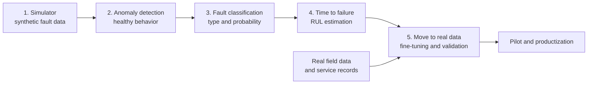
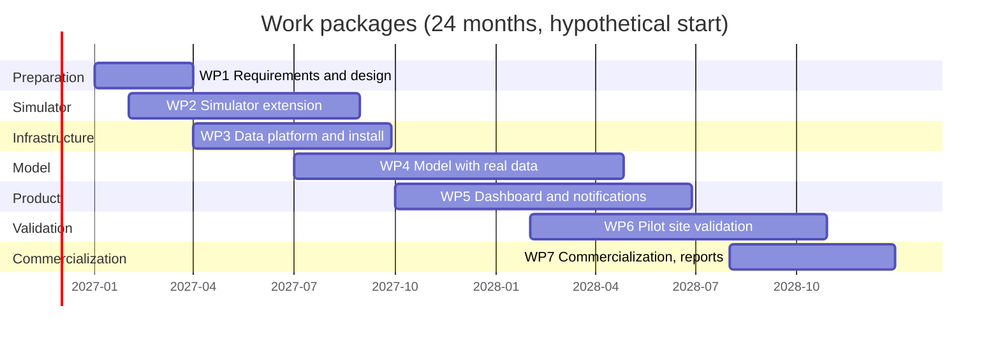

# AI-Powered Refrigeration Fault Prediction — Project Proposal Draft

> **This document is a proposal draft.** It was written to prepare the content of an application to R&D funding programs
> in Türkiye (e.g. TÜBİTAK 1501/1507 or KOSGEB R&D support); **it does not correspond exactly to any official application
> template.** The program, call and eligibility conditions must be checked against the current program texts, and the
> content adapted to the relevant template.
>
> Bracketed expressions (`[...]`) are **placeholders to be filled in**. The "targets" in this document are planned success
> criteria, not achieved results. The current prototype's results are on synthetic data only (see
> [model-card.md](model-card.md)).

| | |
|---|---|
| Project title | AI-Powered Refrigeration Fault Prediction |
| Applicant organization | [Company name and title] |
| Project duration (suggested) | 24 months |
| Target program | [Program and call to be decided] |
| Project lead | [Name Surname, title] |
| Draft date | [dd.mm.yyyy] |

## Contents

1. [Summary](#1-summary)
2. [Problem and motivation](#2-problem-and-motivation)
3. [Aim and objectives](#3-aim-and-objectives)
4. [Innovation / original value](#4-innovation--original-value)
5. [Method](#5-method)
6. [Work packages and timeline](#6-work-packages-and-timeline)
7. [Risks and fallback plans](#7-risks-and-fallback-plans)
8. [Wider impact and commercialization](#8-wider-impact-and-commercialization)
9. [Budget items](#9-budget-items)
10. [Team](#10-team)
11. [Current status: demo prototype](#11-current-status-demo-prototype)

---

## 1. Summary

Cold rooms and commercial refrigeration systems are critical infrastructure for storing products such as food, dairy,
meat, pharmaceuticals and flowers. Faults in these systems are usually not sudden but **the result of degradation lasting
days to weeks**: a refrigerant leak, a fouled condenser, an icing evaporator, a wearing compressor or a failing condenser
fan leaves small but systematic changes in pressure, temperature, current and vibration signals. Today these changes are
often noticed only after the fault has happened.

This project aims to develop a predictive-maintenance system that continuously takes measurements from refrigeration
units, **detects a fault before it happens, identifies its type and estimates the time left until failure**. The system
has four layers: (1) sensor and gateway infrastructure on site, (2) a time-series data platform, (3) anomaly detection that
learns healthy behavior, together with fault-type classification and time-to-failure models, (4) a monitoring dashboard
that delivers alerts to the service team.

Because there is no labeled real fault data, the approach is based on **pre-training in a physics-based simulator** followed
by **fine-tuning with real data collected at pilot sites** (transfer). The simulator is ready as a working demo prototype
for 5 fault types. The main work of the project is to validate this approach with real equipment and real data,
productize it and obtain measurable field performance values.

**Keywords:** predictive maintenance, refrigeration, cold room, anomaly detection, remaining useful life (RUL),
Internet of Things (IoT), transfer learning.

## 2. Problem and motivation

### 2.1 Problem

- An unexpected cold-room failure causes **product loss**, emergency service costs, unplanned downtime and customer
  dissatisfaction.
- The current maintenance approach is mostly **reactive** (after a failure) or **calendar-based** (periodic maintenance).
  The reactive approach incurs the fault cost at its highest point; the calendar-based approach can lead to unnecessary
  maintenance and still miss faults.
- Simple threshold alarms on room temperature warn when the fault **shows up in the temperature** (i.e. late); because the
  refrigeration system can compensate for temperature for a while, early symptoms are masked.
- Telling the fault type and urgency apart takes experience; the service team does not know what it will face before going
  on site.

### 2.2 Motivation

- Because a large share of faults progress gradually, they can be noticed days in advance when the right signals are
  monitored **together** (superheat, subcooling, condensing approach, compressor current, vibration, etc.).
- When the fault type is known in advance, the service team can intervene in a planned way with the right spare parts and
  equipment.
- Low-cost IoT sensors, cloud/edge infrastructure and mature machine-learning tools have made such a system accessible to
  small and medium-sized businesses.

### 2.3 Market and demand data

- Size of the commercial refrigeration / cold chain market in Türkiye: **[source and data to be added]**
- Number of cold rooms and commercial refrigeration units: **[source and data to be added]**
- Food loss and fault cost caused by refrigeration: **[source and data to be added]**
- Share of refrigeration systems in energy consumption: **[source and data to be added]**
- Number of refrigeration units in the target customer segments (supermarket chains, food producers, cold storage, logistics,
  pharma/healthcare): **[source and data to be added]**

## 3. Aim and objectives

### 3.1 Main aim

To develop a field-validated, productizable predictive-maintenance system that detects faults in cold-room refrigeration
systems **before** products spoil, identifies their type and estimates the remaining time.

### 3.2 Sub-objectives

1. Build a data-collection infrastructure that can be installed on site, is low-cost and safe (monitoring only, never
   writing to the controller).
2. Increase the simulator's realism by calibrating it with real data and extending it (multiple faults, sensor faults,
   different refrigerants and equipment types).
3. Fine-tune the simulator-pretrained models with real data and validate them in the field.
4. Develop a monitoring dashboard for the service team that is explainable and sends notifications.
5. Clarify the business model and the product package for commercialization.

### 3.3 Measurable objectives

> **The values below are suggested success criteria (targets).** They should be reviewed at the application stage and at
> the start of the project, once the characteristics of the pilot site and the first data have been seen. The prototype's
> results on synthetic data do **not prove** that these targets are achievable.

| # | Indicator | Target | Measurement method |
|---|---|---|---|
| H1 | Number of refrigeration units in the pilot | [N] units, at least [M] different businesses | Installation records |
| H2 | Data availability | At least [X]% of sensor data received completely | Data platform quality report |
| H3 | Fault catch rate (real faults) | Caught before the failure time ≥ [X]% | Matching with service records |
| H4 | Early-warning lead time | Median ≥ [X] hours (≥ 72 hours suggested) | Difference between alarm time and failure/service time |
| H5 | False alarms | ≤ [X] false alarms per unit per month | Technician confirmation |
| H6 | Fault-type accuracy | ≥ [X]% | Comparison with the cause confirmed on site |
| H7 | Time-to-failure estimation error | Median absolute error ≤ [X] hours / [X]% | Realized vs. predicted |
| H8 | Planned intervention rate | Intervention before failure in ≥ [X]% of alerted faults | Service records |
| H9 | End-to-end latency | ≤ [X] min from data ingestion to alert (with hourly features) | System logs |
| H10 | System availability | ≥ [X]% | Monitoring records |

## 4. Innovation / original value

> The positioning claims in this section **must be supported by a detailed literature and competitor analysis:**
> [literature and competitor analysis to be added].

The project's distinguishing aspects:

1. **Label-free start:** even without labeled field fault data, anomaly detection that learns only from healthy operation
   (Isolation Forest) works from day one; supervised models take over as fault labels accumulate.
2. **Simulator-supported pre-training and transfer:** rare and expensive fault data is generated with a physics-based
   simulator to give the models a starting point; they are then fine-tuned with real data.
3. **Domain-specific features:** instead of raw sensors, features derived from refrigeration-cycle knowledge (superheat,
   subcooling, condensing approach, room–evaporator difference, duty cycle, defrost peak temperature) are used. This makes
   the model consistent with a technician's reasoning and explainable.
4. **Fault type + time to failure + urgency together:** instead of just saying "abnormal", the service team is told which
   fault it is, how much time is left and what needs to be done.
5. **Explainability:** every alert shows which signals the model drew attention to and how far they deviate from normal
   operation.
6. **Low-cost, control-independent monitoring:** the system only monitors without interfering with the refrigeration
   controller; it can be fed from existing controllers (over Modbus) or with extra sensors.

## 5. Method

### 5.1 General approach

### 5.2 Simulator

A physics-based simulator (three equipment types: cold room, freezer room and display cabinet; thermostat-controlled
compressor, periodic defrost, door/customer access, daily ambient cycle, an R404A saturation-pressure approximation) with a
progressing severity curve for 5 fault types (refrigerant leak, condenser fouling, evaporator icing, compressor wear,
condenser fan failure) is available. Over the course of the project it will be:

- **Calibrated** with real measurements (signal ranges, noise, dynamics),
- **Extended:** multiple faults, sensor faults, other equipment types (chillers, etc.), different refrigerants, sudden
  faults, demand defrost, the effect of product load.

### 5.3 Anomaly detection

Isolation Forest learns only from healthy operating data. Its output is an anomaly score between 0 and 1. Because it needs
no labels, it can be used in the first days at a pilot site; it also provides a safety net against fault types the model
has not been trained on. In the field, healthy behavior will be calibrated separately for each unit or group of units.

### 5.4 Fault-type classification

On hourly features (12-hour rolling window), gradient-boosted decision trees (histogram-based) separate 5 fault types +
the normal class; the probability output is a component of the health score
(`health = 100·(0.6·P(normal) + 0.4·(1−anomaly))`). Within the project, the fault types will be extended and probability
calibration will be applied.

### 5.5 Time-to-failure (RUL) estimation

On fault-labeled data, the time left until failure is regressed (on a log scale). Beyond a single point estimate, adding an
**uncertainty interval** (e.g. quantile regression or conformal prediction) is planned, because real degradation rates vary
a lot from fault to fault.

### 5.6 Moving to real data (transfer)

1. Installing sensors and IoT gateways at pilot sites, or reading from existing controllers.
2. **Shadow mode:** 1–3 months of data collection without sending alerts; matching service records with faults.
3. Comparing simulator and real data distributions; simulator calibration.
4. Fine-tuning the simulator-trained model with real data; recalibrating features and thresholds.
5. Field validation: catch rate, early-warning lead time, false alarms, time-to-failure error.
6. Continuous learning: labeling with service feedback and periodic retraining.

For details of the field infrastructure: [field-architecture.md](field-architecture.md).

### 5.7 Evaluation principles

- Testing is done on **units and businesses** not used in training; a time-based split is applied.
- Not only hourly accuracy but also **catch rate, early-warning lead time and false-alarm rate** are considered.
- Results are reported with uncertainty intervals; a small-sample warning is given.
- The Model Card ([model-card.md](model-card.md)) is updated with every version.

## 6. Work packages and timeline

> The durations are **suggestions**; they will be revised according to the sites and the team. A total duration of
> 24 months is assumed.

| WP No | Work package | Months | Outputs | Success criterion |
|---|---|---|---|---|
| WP1 | Requirements analysis, pilot site selection and sensor/architecture design | 1–3 (3 months) | Requirements document; pilot site list; sensor and gateway selection; field architecture design | Written agreement for pilot sites (at least [M] businesses); approved sensor/architecture design |
| WP2 | Extending and calibrating the simulator | 2–8 (7 months) | Extended simulator (multiple faults, sensor faults, new equipment/refrigerant types); calibration report with real data | Simulator signal distributions meet the closeness criterion set with real data: [criterion to be decided] |
| WP3 | Data-collection infrastructure and pilot installation | 4–9 (6 months) | Gateway software; MQTT/time-series data platform; installation on [N] units; data-quality monitoring | Meeting targets H1 and H2 |
| WP4 | Model development with real data | 7–16 (10 months) | Fine-tuned anomaly/classification/time-to-failure models; uncertainty estimation; sensor-fault detection; updated Model Card | Meeting targets H3–H7 on pilot data (on held-out units) |
| WP5 | Monitoring dashboard and notification system | 10–18 (9 months) | Multi-tenant dashboard; SMS/WhatsApp/email notifications; service workflow integration; authorization | User acceptance tests (service team); H9 and H10 |
| WP6 | Pilot site validation | 14–22 (9 months) | Live alert period; results matched with service records; field validation report | Measuring and reporting targets H3–H8 in the live pilot |
| WP7 | Commercialization, dissemination and reporting | 20–24 (5 months) | Business model and pricing; product package; go-to-market plan; final project report | First commercial pilot contract/letters of intent: [number to be decided]; accepted final report |

**Project management, reporting and data security** activities continue throughout the project.

### Timeline

> The dates in the chart use a **hypothetical start** (January 2027) only to show the monthly scale; the real dates will be
> set according to the application and approval process.

## 7. Risks and fallback plans

| # | Risk | Likelihood | Impact | Prevention / mitigation | Fallback plan |
|---|---|---|---|---|---|
| R1 | **Sim-to-real gap:** the simulator-trained model performs poorly on real data | High | High | Early pilot data collection; shadow mode; simulator calibration; fine-tuning | Retraining weighted towards real data; serving with label-free anomaly detection first |
| R2 | **Not enough real fault data can be collected** (faults are rare) | High | High | Many units and businesses; using historical service records; controlled/synthetic fault trials (e.g. covering the condenser or disabling the fan during maintenance — only under safe and approved conditions) | Extending the pilot; narrowing the fault-type scope (focusing on the most common faults) |
| R3 | **Sensor reliability and data quality** (disconnection, drift, stuck values) | Medium | High | Sensor health checks; calibration; data-quality monitoring; a sensor-fault detection model | Backup sensors; cross-using controller data for critical quantities |
| R4 | **False-alarm fatigue**, loss of user trust | Medium | High | Consecutive-hours rule; threshold calibration; prior evaluation in shadow mode; feedback | Tightening thresholds; high-confidence alerts only; a technician approval flow |
| R5 | **Site access and business permission**, pilot businesses dropping out | Medium | Medium | Written agreement in advance; a list of backup businesses; minimally invasive installation | Alternative pilot businesses; a test rig at our own premises |
| R6 | **Connectivity problems** (internet outages, coverage) | Medium | Medium | Local buffering on the gateway; resending; cellular backup | Bulk transfer of data afterwards |
| R7 | The model **fails to generalize** because of equipment diversity (brand, refrigerant, capacity) | Medium | Medium | Unit metadata; per-unit calibration; retraining | Models specific to equipment groups |
| R8 | **Security and data privacy** (network attacks, customer data) | Low–Medium | High | TLS, device authentication, network separation, read-only architecture; KVKK (Turkish personal data protection law) assessment | Security audit; data minimization |
| R9 | **Team and schedule risk** (qualified staff, delays) | Medium | Medium | Flexibility in work packages; consultancy/university collaboration | Narrowing the scope; outsourcing |
| R10 | **Market acceptance and price sensitivity** | Medium | Medium | Early customer interviews; packaging by use case | Making the service model (monthly subscription / service contract) more flexible |
| R11 | **False confidence risk:** over-reliance on the system saying "normal" | Medium | High | Clearly stating the scope limits; the system does not replace protective equipment | Keeping existing maintenance procedures in place |

## 8. Wider impact and commercialization

### 8.1 Expected impact

- **Economic:** fewer unplanned failures and less product loss, planned maintenance and spare-parts management, energy
  efficiency gains (e.g. early removal of excess consumption caused by a dirty condenser or icing). The magnitudes will be
  measured after the pilot: **[measurement and source to be added]**.
- **Social / environmental:** less food loss and waste; reduced environmental impact through early detection of refrigerant
  leaks (impact of leak detection: **[source and data to be added]**).
- **Technological:** a data-driven maintenance culture in the refrigeration sector; a domestic predictive-maintenance
  product and know-how in model development supported by synthetic data/simulation.

### 8.2 Target customer segments

Supermarket and retail chains, food producers and wholesalers, cold storage and logistics companies, pharmaceutical/healthcare
warehouses, hotels and catering businesses, refrigeration service companies (as a service to their own customers). Market
size and segment weights: **[source and data to be added]**.

### 8.3 Business model options

| Option | Description | Pros | Cons | Price |
|---|---|---|---|---|
| **SaaS — monthly subscription per unit** | The customer pays a monthly fee for each monitored refrigeration unit; dashboard + alerts + model included | Predictable revenue; scalable | Hardware cost and installation may need a separate line item | [price to be decided] |
| **Hardware + subscription** | The sensor/gateway package is sold once or rented; the software is a subscription | Hardware cost is covered | The upfront cost may be high for the customer | [price to be decided] |
| **Integrated into service contracts (B2B2B)** | Refrigeration service companies add the system to their own maintenance contracts | Existing customer relationships; fast spread | Dependence on service companies | [price to be decided] |
| **Outcome-based** | A share of the failures prevented or the savings achieved | Low risk for the customer | Hard to measure and prove; revenue uncertainty | [model and rate to be decided] |
| **Installation + consulting** | One-off installation and analysis projects | Fast revenue | No recurring revenue | [price to be decided] |

### 8.4 Commercialization steps

1. Reporting the pilot results and reference customer cases.
2. Defining the product packages (starter / standard / enterprise).
3. Sales and channel strategy (direct sales, service companies, distributors): [strategy to be decided].
4. Setting up support, installation and field service processes.
5. Intellectual property assessment (software copyright, trademark, possible patent/utility model eligibility): [to be
   assessed].

### 8.5 Competition

The market has temperature monitoring, remote monitoring and threshold-based alarm solutions. The scope, prices and methods
of competing products should be studied and included here: **[competitor analysis to be added]**.

## 9. Budget items

> Only the item categories are given; the amounts will be filled in at the application stage based on quotes and program
> rules. Which items are supported by the program must be checked in the relevant call text.

| Item | Description | Amount |
|---|---|---|
| Personnel | Project lead, data scientist/ML engineer, embedded/IoT engineer, software developer, refrigeration technician/engineer | [amount] |
| Machinery–equipment / hardware | Sensors (pressure, temperature, current, vibration, door), gateways, panels, cabling, test rig | [amount] |
| Software and cloud services | Cloud infrastructure, database, monitoring, notification services (SMS/WhatsApp), development tools | [amount] |
| Services | Consulting, university/research institution collaboration, security audit, legal/KVKK consulting | [amount] |
| Travel | Site visits, installation and maintenance | [amount] |
| Consumables | Mounting material, cables, connectors, spare sensors | [amount] |
| Testing and validation | Calibration services, reference measuring instruments | [amount] |
| Intellectual property / promotion | Trademark/patent applications, promotional material | [amount] |
| Overheads | According to program rules | [amount] |
| **Total** | | **[total]** |

## 10. Team

| Role | Name Surname | Tasks and responsibilities | Expertise / experience | Time allocation |
|---|---|---|---|---|
| Project lead | [Name Surname] | Overall management, site and customer relations | [info to be added] | [%] |
| Data scientist / ML engineer | [Name Surname] | Simulator, features, model development | [info to be added] | [%] |
| Embedded / IoT engineer | [Name Surname] | Sensors, gateway, MQTT | [info to be added] | [%] |
| Software developer | [Name Surname] | Data platform, dashboard, notifications | [info to be added] | [%] |
| Refrigeration expert / service engineer | [Name Surname] | Fault knowledge, field validation, labeling | [info to be added] | [%] |
| Advisor / academic collaboration | [Institution / Name Surname] | Methodology advice | [info to be added] | [%] |

Applicant organization's history, capacity and references: **[company information to be added]**.

## 11. Current status: demo prototype

The prototype in this repository is the project's starting point:

- Physics-based simulator (cold room, freezer, display cabinet) and 5 fault types.
- Anomaly detection (Isolation Forest), fault classification and time-to-failure regression (histogram-based gradient
  boosting).
- Health score and Normal / Watch / Critical states; explainable signal deviations.
- Streamlit monitoring dashboard and a 30-day live playback scenario.
- Results on the synthetic test fleet (60 units: 30 cold rooms, 15 freezers, 15 display cabinets): hourly accuracy 99.4%,
  macro F1 0.989, 32/32 caught before failure, median early warning ≈ 6.6 days, 0/60 false alarms. **These values are on
  synthetic data** and do not represent real field performance. Details and limitations: [model-card.md](model-card.md).

In our own assessment, this work is at the **proof-of-concept** stage (laboratory/simulation level); a formal technology
readiness level (TRL) statement should be made at the time of application: **[TRL assessment to be added]**.
The project's goal is to turn the system into a product validated in a real business environment.
